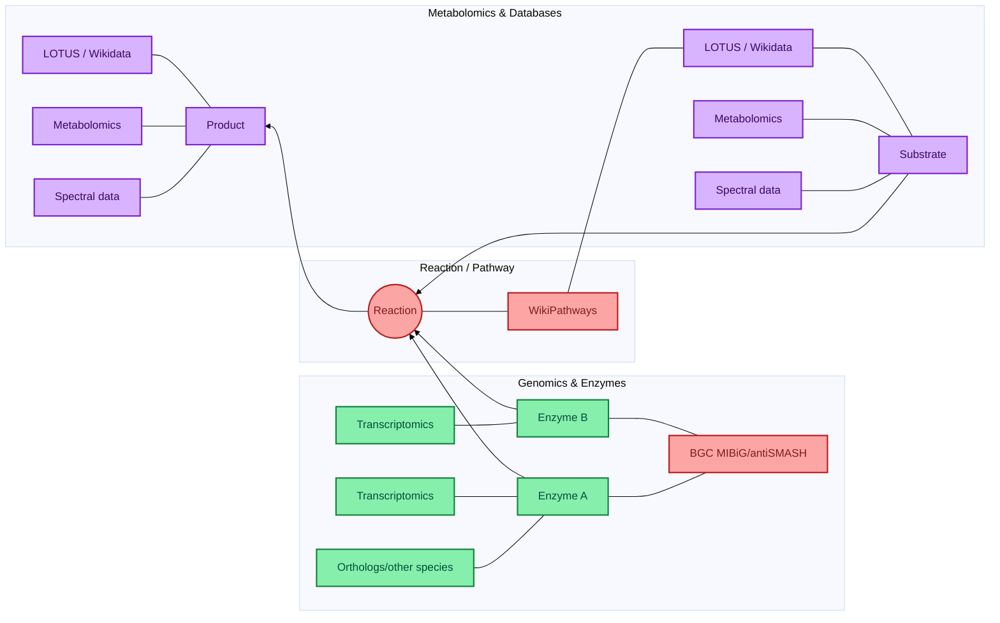
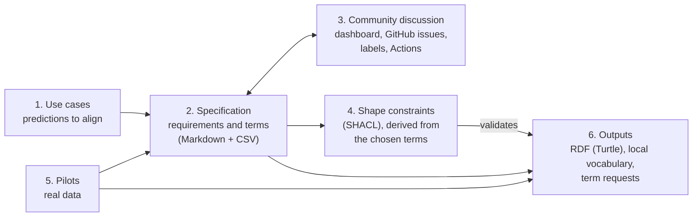
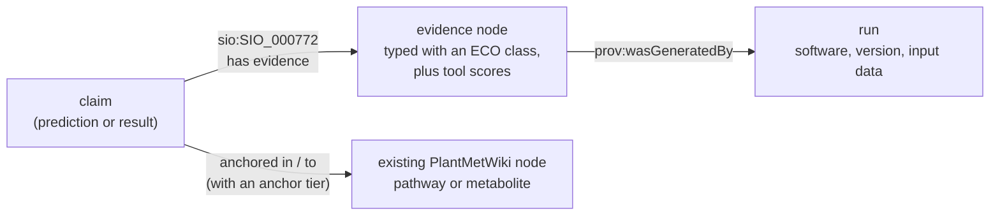

# BioHackathon Project 3: aligning predictions and experimental data with the PlantMetWiki knowledge graph

- [Project page and abstract](https://github.com/elixir-europe/biohackathon-projects-2026/blob/main/3.md) (ELIXIR BioHackathon Europe 2026)
- [ELIXIR BioHackathon Europe 2026](https://biohackathon-europe.org/)
- [Collaborative Google doc](https://docs.google.com/document/d/1rzbnRQLCf-iMgQG8XEfBdkGMdMxM0h0J9rloR8ZC2vE/edit?tab=t.0#heading=h.jbaphzt6t7wb)
- [Specification dashboard](https://pathway-lod.github.io/lod-pathways-community/) (browse, filter and discuss the ontology terms)

## Project 3: Overall aim and objectives

Our project aims to expand our plant metabolism knowledge graph ([PlantMetWiki](https://plantmetwiki.bioinformatics.nl/)) with predictions from (multi)-omics plant knowledge coming from the community. This requires establishing community-supported standards with feedback from the plant science community.

This repository builds those standards: an **evidence model** that says, for any prediction or experimental result attached to a PlantMetWiki pathway, enzyme, gene or metabolite, *why it is believed* (a typed evidence statement), *where it comes from* (tool, version, input data) and *how strongly it is anchored* in the knowledge graph. Users can then filter the graph by the kind of support behind a statement. The terms come from existing ontologies wherever possible; what no ontology provides is collected as candidates for new terms.

## Project 3 Co-Leads 
- Elena Del Pup, Wageningen University & Research, elena.delpup@wur.nl
- Denise Slenter
- Kumar Saurabh Singh

## The knowledge graph that predictions attach to



## The pipeline

The work follows six steps. Each step has its own place in the repository and its own documentation; this README only connects them.



| Step | What happens | Where | Documentation |
|---|---|---|---|
| 1. Define the use cases | Choose the kinds of predictions and experimental data that should be aligned with PlantMetWiki, and what each needs to say. Four evidence cases are described [below](#use-cases-and-evidence-cases); the specification has seven use cases (PMN, BGC, MET, PO, UN, TX, COM) | this README and the use-case sections of the specification | [`specification/SPECIFICATION.md`](specification/SPECIFICATION.md) |
| 2. Specify the terms | For each use case: the requirements (what must be said), the candidate ontology terms, and the gaps. One row per requirement and term in a table, the written text in Markdown. Term IDs and labels are checked against the EBI Ontology Lookup Service | [`specification/SPECIFICATION.md`](specification/SPECIFICATION.md) and [`specification/ontology_terms.csv`](specification/ontology_terms.csv) (source of truth) | [`specification/SPECIFICATION.md`](specification/SPECIFICATION.md#how-to-edit) |
| 3. Edit and discuss together | The table is shown as a [web dashboard](https://pathway-lod.github.io/lod-pathways-community/) on GitHub Pages. Each requirement has GitHub issues for questions and term suggestions (issue forms); a label set by a maintainer on an issue produces a pull request that changes the table | [dashboard](https://pathway-lod.github.io/lod-pathways-community/), [`.github/ISSUE_TEMPLATE/`](.github/ISSUE_TEMPLATE/), [`.github/workflows/`](.github/workflows/) | [`specification/README.md`](specification/README.md): how to discuss, labels, Actions, one-time setup |
| 4. Derive shape constraints | The chosen terms become SHACL shapes that say what a statement must contain before it can be added to the knowledge graph. Problems are either rejected (violations) or flagged (warnings) | [`shape_constraints/`](shape_constraints/) | [`shape_constraints/README.md`](shape_constraints/README.md) |
| 5. Test on pilot data | Each use case is tried on a real dataset to see how much of it aligns with PlantMetWiki and which evidence is available | [`pilots/`](pilots/) | the README and notebook of each pilot |
| 6. Outputs | The generated RDF (Turtle files, validated against the shapes), a sample graph, the local placeholder vocabulary (`lodp:`) for terms that no ontology provides, and the terms to propose to larger ontologies | [`shape_constraints/rdf/`](shape_constraints/rdf/), [`examples/`](examples/), [`shape_constraints/vocab/lodp.ttl`](shape_constraints/vocab/lodp.ttl) | [`examples/README.md`](examples/README.md); the placeholder terms and the term requests are discussed in the dashboard (see the [requests table](specification/SPECIFICATION.md#terms-to-request-from-existing-ontologies)) |

**Terms that no ontology provides** are not listed here: they are rows of the specification table (and so editable and discussable on the dashboard), with the action `local_term` while a placeholder is used and `request_term` when a term should be proposed to an existing ontology such as ECO, STATO or PSI-MS. Example: a request to ECO for *metabolite-transcript correlation evidence* (no such term exists; `ECO:0007590` is the closest).

## Use cases and evidence cases

Every prediction is modelled the same way, so that predictions of different kinds can be queried together:



The four evidence cases on which the specification started:

| # | Case | Specification use case | Test data | Pilot |
|---|---|---|---|---|
| 1 | Biosynthetic gene cluster (BGC) predictions | BGC | plantiSMASH 2.0 precalculated database, about 30,400 BGCs in 430 genomes | [`pilots/plantismash_overlap`](pilots/plantismash_overlap/) |
| 2 | Paired-omics metabolite-transcript correlations | PO | Tomato data of the [MEANtools paper](https://journals.plos.org/plosbiology/article?id=10.1371/journal.pbio.3003307) (Kumar et al.) | [`pilots/meantools_overlap`](pilots/meantools_overlap/) |
| 3 | Metabolite annotation: consensus of MS/MS tools (SIRIUS, MS2Query, DreaMS) and mass-only matches | MET | Brassicaceae metabolic fingerprinting, Wolters et al. 2026 ([GitHub](https://github.com/capsicumbaccatum/Metabolic_fingerprinting_consensus_annotation), [Zenodo](https://doi.org/10.5281/zenodo.19391098)) | [`pilots/metabolomics_overlap`](pilots/metabolomics_overlap/) |
| 4 | Computational predictions of the (extended) PlantCyc | PMN | PlantCyc evidence codes on PlantMetWiki nodes | [`shape_constraints/rdf/plantcyc.ttl`](shape_constraints/rdf/plantcyc.ttl) |

The specification adds three use cases: transcriptomics data (TX), unsupervised predictions such as graph neural network link prediction (UN), and the terms shared by all use cases (COM).

A complete example that attaches one claim of each case to PlantMetWiki, with the validation and a query over it, is in [`examples/`](examples/README.md).

## Repository map

| Folder | Content |
|---|---|
| [`specification/`](specification/) | Written specification, the term table, the dashboard and the scripts that keep them in sync; the documentation of the discussion workflow |
| [`shape_constraints/`](shape_constraints/) | SHACL shapes, the placeholder vocabulary, scripts that validate RDF and generate it from the pilot results, the generated RDF and the tests |
| [`pilots/`](pilots/) | Three analyses on real data, each with README, notebook and results |
| [`examples/`](examples/) | A sample evidence graph and a query over it |
| [`docs/`](docs/) | Design notes, for example on collaborative annotation with Nanodash |
| [`.github/`](.github/) | Issue forms and the GitHub Actions of the discussion workflow |

Validation rules are written in SHACL (a W3C Recommendation) and checked with pyshacl; a reference check tests that the PlantMetWiki pathways and metabolites a claim refers to exist in a dated snapshot. See [`shape_constraints/README.md`](shape_constraints/README.md).

Quick start:

```bash
cd specification && python check_terms.py                                    # validate the term table
cd ../shape_constraints && .venv/bin/python validate.py ../examples/sample_evidence_graph.ttl   # validate the sample graph
```

## Contributing

Open the [dashboard](https://pathway-lod.github.io/lod-pathways-community/), find a requirement, and use its buttons to start a discussion or suggest a term. How this works, and what maintainers do with labels, is described in [`specification/README.md`](specification/README.md). New requirements are proposed with the issue form *Propose a new requirement*.

## Resources
- [Knowledge Graphs for Plant and Microbiome Multi-omics symposium (YouTube recording)](https://www.youtube.com/watch?v=NgYRHiuBvpc)
- [FAIR Data Fund use case: Catalyzing plant natural product discovery with a community-driven knowledge base](https://community.data.4tu.nl/2025/11/04/fair-data-fund-use-case-catalyzing-plant-natural-product-discovery-with-a-community-driven-knowledge-base/)
- PlantMetWiki: [preprint](https://www.biorxiv.org/content/10.64898/2026.07.22.733699v1) and [SPARQL endpoint](https://plantmetwiki.bioinformatics.nl/sparql)
- Targeted Brainstorming - 14 October: [Google doc notes](https://docs.google.com/document/d/15J9CHluMGA2IqFc5C-PF6YFRhbDHEHFe0tTbf9sYd4U/edit?tab=t.0)

## Funding
This project was initially funded by the FAIR Data Fund 2025 of 4TU.ResearchData to EDP, and subsequently by the EPS Graduate School (2026 Travel Fellowship to EDP) and the University Fund Wageningen (2026 Travel Fellowship to EDP). The ELIXIR BioHackathon Europe 2026 accepted the work as Project 3 and funded the stay of two of its co-leaders.
