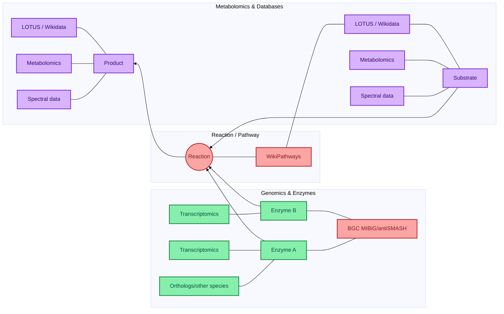

# LOD-pathways-community

This file serves as a reference for establishing a community of collaborators around a knowledge base to annotate pathway. 

## Overall aim and objectives

## Milestones 
- Write a collaborative whitepaper/opinion paper/review to agree on the vision 

## Collaborators (confirmed) 
- Elena Del Pup, Wageningen University, elena.delpup@wur.nl
- Marnix Medema 
- Justin van der Hooft
- Mitja Zdouc
- Tito Damiani
- Adriano Rutz
- Pierre-Marie Allard
- Denise Slenter
- Egon Willighagen
- Louis Felix Nothias
- Daniel Probst 

## Other potential collaborators (to be confirmed) 
- Yasin El Abiead
- Fabien Gandon at the INRIA

## Targeted Brainstorming - 14 October 
[Google doc notes](https://docs.google.com/document/d/15J9CHluMGA2IqFc5C-PF6YFRhbDHEHFe0tTbf9sYd4U/edit?tab=t.0)

## Mermaid plot for rendering of the knowledge graph 

## Prototype: aligning predictions with PlantMetWiki (work in progress)

Goal: attach computational predictions to nodes of the [PlantMetWiki](https://www.biorxiv.org/content/10.64898/2026.07.22.733699v1) knowledge graph (pathways, reactions, enzymes, metabolites). Each prediction should carry a typed **evidence** statement so users can filter by the kind of support behind it.

### Shared pattern for every prediction

Every case below is modelled the same way, so they can be queried together:

| Element | What it records | Candidate vocabulary |
|---|---|---|
| Subject → object | e.g. BGC → pathway, gene → metabolite, feature → compound class | PlantMetWiki node IRIs, Wikidata QIDs |
| Evidence type | *Why* we believe the link | [ECO](https://www.evidenceontology.org/) (Evidence & Conclusion Ontology) |
| Provenance | Which tool, which version, which input data | [PROV-O](https://www.w3.org/TR/prov-o/) (`prov:wasGeneratedBy`, `prov:used`), `SWO:0004000` *has version* |
| Score / strength | Numeric confidence from the tool | [STATO](https://stato-ontology.org/) / [OBI](https://obi-ontology.org/) terms, or tool-specific literals |
| Match quality | Complete vs partial agreement with a reference | [SKOS](https://www.w3.org/TR/skos-reference/) `skos:exactMatch` / `skos:closeMatch` / `skos:relatedMatch` |

### The four evidence cases

| # | Case | Test data | Evidence ontology status |
|---|---|---|---|
| 1 | BGC predictions (plantiSMASH) | to be defined | No ontology used by the tools → needs a mapping (see below) |
| 2 | Paired-omics metabolite–transcript (M-T) correlations (MEANtools) | Tomato data from the [MEANtools paper](https://journals.plos.org/plosbiology/article?id=10.1371/journal.pbio.3003307) | Needs a mapping |
| 3 | Consensus annotation from MS/MS tools (SIRIUS, MS2Query, DreaMS) | Brassicaceae tables and code from Felicia Wolters ([GitHub](https://github.com/capsicumbaccatum/Metabolic_fingerprinting_consensus_annotation), [Zenodo](https://doi.org/10.5281/zenodo.19391098)) | Needs a mapping |
| 4 | Computational predictions from the extended PlantCyc | PlantCyc | Already has its own evidence types → map to ECO |

#### 1. BGC predictions

Statements we want to express, with candidate terms:

| Statement | Candidate term(s) | Notes |
|---|---|---|
| There is a BGC | `SO:0002357` *biosynthetic_gene_cluster* (type of the node) | |
| …predicted computationally from the genome | `ECO:0000256` *match to sequence model evidence used in automatic assertion* (pHMM domain hits); `ECO:0007327` *genomic context evidence used in automatic assertion* (co-located genes) | UniProt uses `ECO:0000256` for pHMM-based annotations |
| The BGC is detected by rule X | **No existing term.** Custom property, e.g. `lodp:detectionRule "terpene"` | Values = plantiSMASH rule / cluster-type names |
| The BGC comes from plantiSMASH version X | `prov:wasGeneratedBy` → a plantiSMASH run, with `SWO:0004000` *has version* | |
| Complete / partial match with a MIBiG BGC | `skos:exactMatch` (complete) or `skos:closeMatch` (partial) → MIBiG accession (`BGC000xxxx`); `ECO:0000044` *sequence similarity evidence* + similarity % | Define a threshold for complete vs partial |
| The BGC has X overlap with pathway nodes | `SIO:000325` *overlaps with* → PlantMetWiki pathway, plus a numeric overlap value | Define the metric, e.g. fraction of the pathway's enzymes encoded in the BGC |

Open questions:
- [ ] Do any BGC tools (antiSMASH, plantiSMASH, MIBiG) already export evidence terms? As far as we know, antiSMASH/plantiSMASH outputs don't use ECO. MIBiG has its own controlled vocabulary for how a BGC–compound link was shown (e.g. heterologous expression, knock-out), which could be mapped to ECO.
- [ ] Where do the BGC predictions come from for the prototype (species, plantiSMASH version)?

#### 2. Paired-omics M-T correlations (MEANtools)

| Statement | Candidate term(s) |
|---|---|
| Transcript and metabolite abundances are correlated | `ECO:0007829` *combinatorial computational and experimental evidence used in automatic assertion* |
| Correlation metric | `STATO:0000280` *Pearson's correlation coefficient* / `STATO:0000201` *Spearman's rank correlation coefficient* |
| Significance | `OBI:0000175` *p-value* |
| Expression-based support | `ECO:0007298` *expression pattern evidence used in automatic assertion* |

- [x] Check which metrics MEANtools actually outputs: Pearson r and p-value, mutual rank, edge weight per decay rate, and ClusterONE functional clusters with a p-value.
- [ ] Request an ECO term for metabolite–transcript correlation evidence (none exists; `ECO:0007590` is the closest).

Pilot: [pilots/meantools_overlap](pilots/meantools_overlap/) maps the MEANtools tomato functional clusters to PlantMetWiki and exports the associations as RDF with this evidence model.

#### 3. Consensus from MS/MS annotation tools

Based on Felicia's consensus module (agreement between SIRIUS/CANOPUS, MS2Query and DreaMS at the InChI and NP.Classifier pathway/superclass/class levels).

| Statement | Candidate term(s) |
|---|---|
| Annotation comes from LC-MS/MS data | `ECO:0001580` *liquid chromatography coupled with tandem mass spectrometry evidence* |
| Several tools were combined automatically | `ECO:0007653` *automatically integrated combinatorial computational evidence used in automatic assertion* |
| Level of agreement | `match_type` full (3/3) / partial (2/3) → `skos:exactMatch` / `skos:closeMatch`, plus `match_score` (1.0 / 0.5) |
| Which tools agreed | `prov:wasGeneratedBy` per tool, with version |

- [ ] Decide whether to also record the Metabolomics Standards Initiative (MSI) identification level.

Pilot: [pilots/metabolomics_overlap](pilots/metabolomics_overlap/) measures how many of these annotations match PlantMetWiki metabolites.

#### 4. Extended PlantCyc computational predictions

PlantCyc already assigns evidence types to its predictions.
- [ ] List the evidence types used in the extended PlantCyc predictions.
- [ ] Map them to ECO so they can be queried together with cases 1–3 (e.g. computational inference → `ECO:0007669` *computational evidence used in automatic assertion*).

# Git track 
Committed to GitHub with https://github.com/Vinzent03/obsidian-git 

## Resources
- [Knowledge Graphs for Plant and Microbiome Multi-omics symposium (YouTube recording)](https://www.youtube.com/watch?v=NgYRHiuBvpc)
- [FAIR Data Fund use case: Catalyzing plant natural product discovery with a community-driven knowledge base](https://community.data.4tu.nl/2025/11/04/fair-data-fund-use-case-catalyzing-plant-natural-product-discovery-with-a-community-driven-knowledge-base/)

## Funding
This project was initially funded by the FAIR Data Fund 2025 of 4TU.ResearchData, and subsequently by the EPS Graduate School and the University Fund Wageningen.
