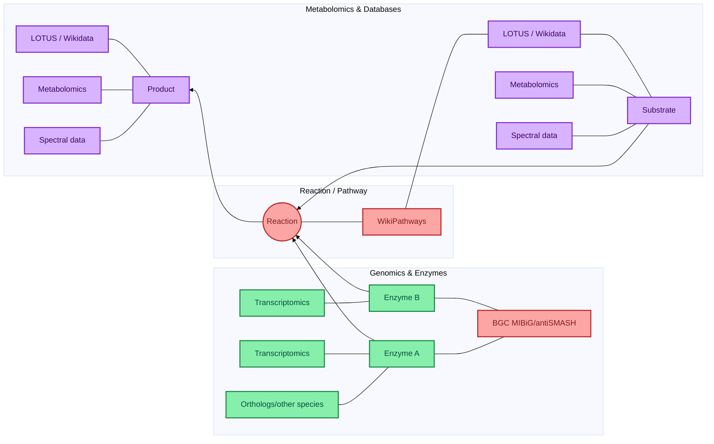
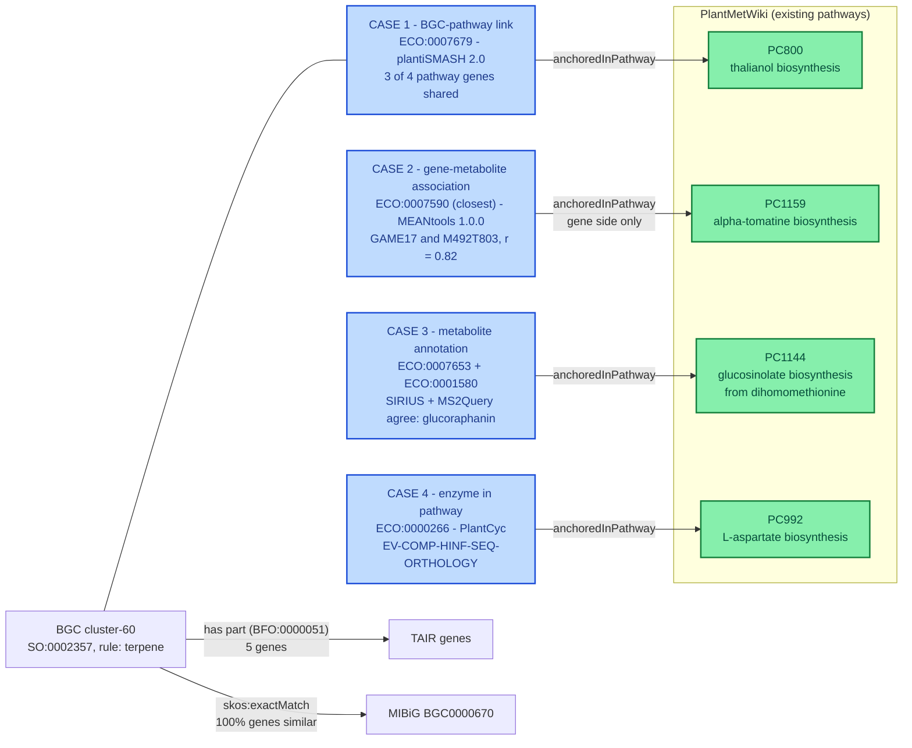

# LOD-pathways-community

This file serves as a reference for establishing a community of collaborators around a knowledge base to annotate pathway. 

## Overall aim and objectives

## Milestones 
- Write a collaborative whitepaper/opinion paper/review to agree on the vision 

## Collaborators (confirmed) 
- Elena Del Pup, Wageningen University, elena.delpup@wur.nl
- Marnix Medema 
- Justin van der Hooft
- Mitja Zdouc
- Tito Damiani
- Adriano Rutz
- Pierre-Marie Allard
- Denise Slenter
- Egon Willighagen
- Louis Felix Nothias
- Daniel Probst 

## Other potential collaborators (to be confirmed) 
- Yasin El Abiead
- Fabien Gandon at the INRIA

## Targeted Brainstorming - 14 October 
[Google doc notes](https://docs.google.com/document/d/15J9CHluMGA2IqFc5C-PF6YFRhbDHEHFe0tTbf9sYd4U/edit?tab=t.0)

## Mermaid plot for rendering of the knowledge graph 



## Prototype: aligning predictions with PlantMetWiki (work in progress)

Goal: attach computational predictions to nodes of the [PlantMetWiki](https://www.biorxiv.org/content/10.64898/2026.07.22.733699v1) knowledge graph (pathways, reactions, enzymes, metabolites). Each prediction should carry a typed **evidence** statement so users can filter by the kind of support behind it.

### Shared pattern for every prediction

Every case below is modelled the same way, so they can be queried together:

| Element | What it records | Candidate vocabulary |
|---|---|---|
| Subject → object | e.g. BGC → pathway, gene → metabolite, feature → compound class | PlantMetWiki node IRIs, Wikidata QIDs |
| Evidence type | *Why* we believe the link | [ECO](https://www.evidenceontology.org/) (Evidence & Conclusion Ontology) |
| Provenance | Which tool, which version, which input data | [PROV-O](https://www.w3.org/TR/prov-o/) (`prov:wasGeneratedBy`, `prov:used`), `SWO:0004000` *has version* |
| Score / strength | Numeric confidence from the tool | [STATO](https://stato-ontology.org/) / [OBI](https://obi-ontology.org/) terms, or tool-specific literals |
| Match quality | Complete vs partial agreement with a reference | [SKOS](https://www.w3.org/TR/skos-reference/) `skos:exactMatch` / `skos:closeMatch` / `skos:relatedMatch` |

### The four evidence cases

| # | Case | Test data | Evidence ontology status |
|---|---|---|---|
| 1 | BGC predictions (plantiSMASH) | plantiSMASH 2.0 precalculated database, ~30,400 BGCs in 430 genomes ([pilot](pilots/plantismash_overlap/)) | The tools use no ontology → mapped below; detection rules need a small local vocabulary |
| 2 | Paired-omics metabolite–transcript (M-T) correlations (MEANtools) | Tomato data from the [MEANtools paper](https://journals.plos.org/plosbiology/article?id=10.1371/journal.pbio.3003307) | Only a close ECO term exists; ECO has no metabolite–transcript correlation term |
| 3 | Consensus annotation from MS/MS tools (SIRIUS, MS2Query, DreaMS) | Brassicaceae tables and code from Felicia Wolters ([GitHub](https://github.com/capsicumbaccatum/Metabolic_fingerprinting_consensus_annotation), [Zenodo](https://doi.org/10.5281/zenodo.19391098)) | ECO and PSI-MS terms exist; identification confidence level not yet modelled |
| 4 | Computational predictions from the extended PlantCyc | PlantCyc | Has its own `EV-` codes → proposed mapping to ECO (see below) |

#### 1. BGC predictions

Statements we want to express, with candidate terms:

| Statement | Candidate term(s) | Notes |
|---|---|---|
| There is a BGC | `SO:0002357` *biosynthetic_gene_cluster* (type of the node); its genes via `BFO:0000051` *has part* | PlantMetWiki's BGC graph currently uses `obo:RO_0000051`, which I could not find in the Ontology Lookup Service |
| …predicted computationally from the genome | `ECO:0000256` *match to sequence model evidence used in automatic assertion* (pHMM domain hits); `ECO:0007327` *genomic context evidence used in automatic assertion* (co-located genes) | UniProt uses `ECO:0000256` for pHMM-based annotations |
| The BGC is detected by rule X | **No existing term.** Custom property, e.g. `lodp:detectionRule "terpene"` | Values = plantiSMASH rule / cluster-type names |
| The BGC comes from plantiSMASH version X | `prov:wasGeneratedBy` → a plantiSMASH run, with `SWO:0004000` *has version* | |
| Complete / partial match with a MIBiG BGC | `skos:exactMatch` (complete) or `skos:closeMatch` (partial) → MIBiG accession (`BGC000xxxx`); `ECO:0000249` *sequence similarity evidence used in automatic assertion* + % of genes similar | Define a threshold for complete vs partial |
| The BGC has X overlap with pathway nodes | `RO:0002131` *overlaps* (BGC ↔ PlantMetWiki pathway), plus overlap values (shared genes, fraction of the pathway's genes or ECs) | The overlap properties need local definitions |

Open questions:
- [ ] Do any BGC tools (antiSMASH, plantiSMASH, MIBiG) already export evidence terms? As far as we know, antiSMASH/plantiSMASH outputs don't use ECO. MIBiG has its own controlled vocabulary for how a BGC–compound link was shown (e.g. heterologous expression, knock-out), which could be mapped to ECO.
- [x] Where do the BGC predictions come from for the prototype? The plantiSMASH 2.0 precalculated database (`plantismash.bioinformatics.nl/precalc/v2/`), starting with *A. thaliana*, where BGC genes and PlantCyc genes share TAIR IDs.

Pilot: [pilots/plantismash_overlap](pilots/plantismash_overlap/) links all plantiSMASH 2.0 BGCs to PlantMetWiki genes and pathways and collects the evidence points above.

#### 2. Paired-omics M-T correlations (MEANtools)

| Statement | Candidate term(s) |
|---|---|
| Transcript and metabolite abundances are correlated | `ECO:0007829` *combinatorial computational and experimental evidence used in automatic assertion* |
| Correlation metric | `STATO:0000280` *Pearson's correlation coefficient* / `STATO:0000201` *Spearman's rank correlation coefficient* |
| Significance | `OBI:0000175` *p-value* |
| Expression-based support | `ECO:0007298` *expression pattern evidence used in automatic assertion* |

- [x] Check which metrics MEANtools actually outputs: Pearson r and p-value, mutual rank, edge weight per decay rate, and ClusterONE functional clusters with a p-value.
- [ ] Request an ECO term for metabolite–transcript correlation evidence (none exists; `ECO:0007590` is the closest).

Pilot: [pilots/meantools_overlap](pilots/meantools_overlap/) maps the MEANtools tomato functional clusters to PlantMetWiki and exports the associations as RDF with this evidence model.

#### 3. Consensus from MS/MS annotation tools

Based on Felicia's consensus module (agreement between SIRIUS/CANOPUS, MS2Query and DreaMS at the InChI and NP.Classifier pathway/superclass/class levels).

| Statement | Candidate term(s) |
|---|---|
| Annotation comes from LC-MS/MS data | `ECO:0001580` *liquid chromatography coupled with tandem mass spectrometry evidence* |
| Several tools were combined automatically | `ECO:0007653` *automatically integrated combinatorial computational evidence used in automatic assertion* |
| Level of agreement | `match_type` full (3/3) / partial (2/3) → `skos:exactMatch` / `skos:closeMatch`, plus `match_score` (1.0 / 0.5) |
| Which tools agreed | `prov:wasGeneratedBy` per tool, with version |

- [ ] Decide whether to also record the identification confidence level. Terms exist: `MS:1002896` *compound identification confidence level* (MSI levels) and `MS:1002955` (Schymanski levels) in PSI-MS.

Pilot: [pilots/metabolomics_overlap](pilots/metabolomics_overlap/) measures how many of these annotations match PlantMetWiki metabolites.

#### 4. Extended PlantCyc computational predictions

PlantCyc already assigns evidence types to its predictions.
- [ ] List the evidence types used in the extended PlantCyc predictions.
- [ ] Map them to ECO so they can be queried together with cases 1–3 (e.g. computational inference → `ECO:0007669` *computational evidence used in automatic assertion*).


### Sample graph: the four cases combined

[`examples/sample_evidence_graph.ttl`](examples/sample_evidence_graph.ttl) attaches one real claim from each case to a PlantMetWiki pathway, using the shared pattern above. Identifiers and numbers come from the pilots and the PlantMetWiki SPARQL endpoint (snapshot 2026-09-29), so nothing in it is a new biological claim. The `lodp:` namespace is a placeholder for terms that do not exist in any ontology yet.

The four claims come from different species and datasets, so they meet in the *pattern*, not in one pathway:



Every claim has the same skeleton: `claim → sio:SIO_000772 (has evidence) → evidence node typed with an ECO class → prov:wasGeneratedBy → activity (software, version, input data)`, plus tool-specific scores on the evidence node.

<details>
<summary>The sample graph (Turtle, 111 triples)</summary>

```turtle
# Sample evidence graph: the four cases attached to PlantMetWiki nodes.
#
# All identifiers and numbers are real, taken from the pilots in ../pilots/ and from the PlantMetWiki
# SPARQL endpoint (snapshot 2026-09-29). Nothing here is a new biological claim.
# `lodp:` is a PLACEHOLDER namespace for terms that do not exist in any ontology yet.
#
# Shape shared by all four cases:
#   claim --sio:SIO_000772 (has evidence)--> evidence node (typed with an ECO class)
#   evidence node --prov:wasGeneratedBy--> activity (software, version, input data)
#   claim --lodp:anchoredInPathway--> PlantMetWiki pathway

@prefix lodp:    <https://example.org/lod-pathways/pilot/> .
@prefix pmw:     <http://rdf-plantmetwiki.bioinformatics.nl/pathways/> .
@prefix obo:     <http://purl.obolibrary.org/obo/> .
@prefix sio:     <http://semanticscience.org/resource/> .
@prefix skos:    <http://www.w3.org/2004/02/skos/core#> .
@prefix prov:    <http://www.w3.org/ns/prov#> .
@prefix swo:     <http://www.ebi.ac.uk/swo/> .
@prefix edam:    <http://edamontology.org/> .
@prefix dcterms: <http://purl.org/dc/terms/> .
@prefix rdf:     <http://www.w3.org/1999/02/22-rdf-syntax-ns#> .
@prefix rdfs:    <http://www.w3.org/2000/01/rdf-schema#> .
@prefix xsd:     <http://www.w3.org/2001/XMLSchema#> .
@prefix mibig:   <https://mibig.secondarymetabolites.org/repository/> .
@prefix tair:    <https://identifiers.org/tair.name/> .
@prefix pubmed:  <https://identifiers.org/pubmed/> .

# ---------------------------------------------------------------------------
# PlantMetWiki nodes that the claims are anchored to (these already exist there)
# ---------------------------------------------------------------------------
pmw:PC800  rdfs:label "thalianol and derivatives biosynthesis" ;       # PlantCyc PWY-5992
           lodp:plantcycId "PWY-5992" .
pmw:PC1159 rdfs:label "α-tomatine biosynthesis" ;                      # PlantCyc PWY18C3-3
           lodp:plantcycId "PWY18C3-3" .
pmw:PC1144 rdfs:label "glucosinolate biosynthesis from dihomomethionine" ;   # PlantCyc PWYQT-4471
           lodp:plantcycId "PWYQT-4471" .
pmw:PC992  rdfs:label "L-aspartate biosynthesis" ;                     # PlantCyc ASPARTATESYN-PWY
           lodp:plantcycId "ASPARTATESYN-PWY" .

# GAME17 is listed in PlantMetWiki by its Solyc locus (a property of this DataNode)
<http://rdf-plantmetwiki.bioinformatics.nl/Pathway/PC1159_r17.0.0_20260605-171052/DataNode/G18C3_9>
    rdfs:label "GAME17" ; lodp:solycLocus "Solyc07g043480" ; dcterms:isPartOf pmw:PC1159 .

# ---------------------------------------------------------------------------
# Provenance: one activity per tool run
# ---------------------------------------------------------------------------
lodp:run_plantismash a prov:Activity ;
    rdfs:label "plantiSMASH precalculated database" ;
    lodp:software "plantiSMASH" ; swo:SWO_0004000 "2.0 (precalculated database v2)" ;   # has version
    prov:used <https://plantismash.bioinformatics.nl/precalc/v2/> .

lodp:run_meantools a prov:Activity , edam:operation_3463 , edam:operation_3432 ;   # expression correlation analysis ; clustering
    rdfs:label "MEANtools functional clustering, tomato, fungal treatment, decay rate 10" ;
    lodp:software "MEANtools" ; swo:SWO_0004000 "1.0.0" ;
    prov:used <https://zenodo.org/records/15697913> ;
    lodp:decayRate 10 .

lodp:run_consensus a prov:Activity ;
    rdfs:label "Consensus annotation of SIRIUS, MS2Query and DreaMS" ;
    lodp:software "Consensus_annotator (Annotation_matching_module_update_report_v02.py)" ;
    lodp:usesTool "SIRIUS 6.1.0" , "MS2Query 1.0" , "DreaMS 1.0" ;
    prov:used <https://doi.org/10.5281/zenodo.19391098> .

lodp:run_plantcyc a prov:Activity ;
    rdfs:label "PlantCyc curation, as released in PlantMetWiki" ;
    lodp:software "PlantCyc" ; swo:SWO_0004000 "17.0.0" ;
    prov:used <https://pmn.plantcyc.org/> .

# ===========================================================================
# CASE 1. BGC prediction (plantiSMASH 2.0, Arabidopsis thaliana)
# ===========================================================================
<https://plantismash.bioinformatics.nl/precalc/v2/Arabidopsis_thaliana_GCF_000001735.4/index.html#cluster-60>
    a obo:SO_0002357 ;                                          # biosynthetic_gene_cluster
    rdfs:label "Arabidopsis thaliana cluster-60 (plantiSMASH 2.0)" ;
    obo:BFO_0000051 tair:AT5G47950 , tair:AT5G47980 , tair:AT5G47990 ,   # has part: the 5 biosynthetic genes
                    tair:AT5G48000 , tair:AT5G48010 ;
    # "there is a BGC", "detected by rule X", "from plantiSMASH version X"
    sio:SIO_000772 [
        a obo:ECO_0000256 , obo:ECO_0007327 ;                   # pHMM rule match + genomic co-location
        prov:wasGeneratedBy lodp:run_plantismash ;
        lodp:detectionRule "terpene" ;
        lodp:coreDomain "SQHop_cyclase_C" , "SQHop_cyclase_N" , "Transferase" , "p450"
    ] ;
    # "complete match with a MIBiG BGC" (all genes similar)
    skos:exactMatch mibig:BGC0000670 ;
    lodp:mibigMatchEvidence [
        a obo:ECO_0000249 ;                                     # sequence similarity (KnownClusterBLAST)
        lodp:percentGenesSimilar "100"^^xsd:integer
    ] .

# "X overlap with pathway nodes": the BGC shares 3 of the pathway's 4 TAIR genes
lodp:link_cluster60_PC800 a lodp:BGCPathwayLink ;
    obo:RO_0002131 <https://plantismash.bioinformatics.nl/precalc/v2/Arabidopsis_thaliana_GCF_000001735.4/index.html#cluster-60> ,
                   pmw:PC800 ;                                  # overlaps
    lodp:anchoredInPathway pmw:PC800 ;
    sio:SIO_000772 [
        a obo:ECO_0007679 ;                                     # combinatorial computational evidence, automatic
        prov:wasGeneratedBy lodp:run_plantismash ;
        lodp:linkTier "gene_direct" ;
        lodp:linkingGene "AT5G47990" , "AT5G48000" , "AT5G48010" ;
        lodp:nSharedGenes "3"^^xsd:integer ;
        lodp:nPathwayGenes "4"^^xsd:integer ;
        lodp:fractionPathwayGenes "0.75"^^xsd:double
    ] .

# ===========================================================================
# CASE 2. Paired-omics association (MEANtools, tomato)
# GAME17 (a PlantMetWiki gene) correlated with metabolite feature M492T803.
# The cluster is NOT significant (p = 0.75); the association is shown to illustrate the model.
# ===========================================================================
lodp:assoc_fungal_DR10_C257_Solyc07g043480_M492T803 a sio:SIO_001257 ;   # chemical-gene association
    sio:SIO_000628 <https://plants.ensembl.org/Solanum_lycopersicum/Gene/Summary?g=Solyc07g043480> ,   # refers to
                   lodp:feature_MTBLS1039_M492T803 ;
    lodp:anchoredInPathway pmw:PC1159 ;                         # gene side only: the metabolite is not identified
    lodp:anchoredSide "gene" ;
    lodp:geneMappingTier "gene_locus" ;
    sio:SIO_000772 [
        a obo:ECO_0007590 ;                                     # closest ECO term; none for M-T correlation
        prov:wasGeneratedBy lodp:run_meantools ;
        obo:STATO_0000280 "0.8192"^^xsd:double ;                # Pearson's r
        obo:OBI_0000175 "3.2e-05"^^xsd:double ;                 # p-value of the correlation
        lodp:mutualRank "2.646"^^xsd:double ;
        lodp:edgeWeight "0.8483"^^xsd:double ;
        lodp:functionalCluster "257" ;
        lodp:clusterPValue "0.7475"^^xsd:double
    ] .

# ===========================================================================
# CASE 3. Consensus MS/MS annotation (Brassicaceae, positive mode feature 741)
# SIRIUS and MS2Query agree on glucoraphanin (2 of 3 tools = "partial")
# ===========================================================================
lodp:annotation_MTBLS14270_pos_741 a lodp:MetaboliteAnnotation ;
    lodp:feature lodp:feature_MTBLS14270_pos_741 ;
    skos:closeMatch <https://identifiers.org/inchikey/GMMLNKINDDUDCF-BYNGITTOSA-M> ,   # glucoraphanin (stand-in relation)
                    <http://www.wikidata.org/entity/Q27106767> ;
    lodp:anchoredInPathway pmw:PC1144 ;
    sio:SIO_000772 [
        a obo:ECO_0007653 , obo:ECO_0001580 ;                   # automatically integrated computational + LC-MS/MS
        prov:wasGeneratedBy lodp:run_consensus ;
        lodp:matchType "partial" ;
        lodp:agreementScore "0.5"^^xsd:double ;
        lodp:agreeingTool "SIRIUS" , "MS2Query" ;
        lodp:ms2queryModelScore "0.8512"^^xsd:double ;
        lodp:precursorMzDifference "0.0006"^^xsd:double ;
        lodp:siriusConfidenceApprox "0.43"^^xsd:double
    ] .

# ===========================================================================
# CASE 4. PlantCyc evidence on a PlantMetWiki enzyme node
# The code is stored in PlantMetWiki as a citation property of the node:
#   "22186372:EV-COMP-HINF-SEQ-ORTHOLOGY:3618148918:Mary L Schaeffer"
# ===========================================================================
lodp:claim_GDQC_108527_MONOMER_PC992 a rdf:Statement ;
    rdf:subject <http://rdf-plantmetwiki.bioinformatics.nl/Pathway/PC992_r17.0.0_20260605-171052/DataNode/GDQC_108527_MONOMER> ;
    rdf:predicate dcterms:isPartOf ;
    rdf:object pmw:PC992 ;
    lodp:anchoredInPathway pmw:PC992 ;
    sio:SIO_000772 [
        a obo:ECO_0000266 ;                                     # sequence orthology evidence, manual assertion (proposed mapping)
        prov:wasGeneratedBy lodp:run_plantcyc ;
        lodp:originalEvidenceCode "EV-COMP-HINF-SEQ-ORTHOLOGY" ;
        dcterms:references pubmed:22186372
    ] .
```

</details>

One query over all four cases, [`examples/claims_by_evidence.rq`](examples/claims_by_evidence.rq), lists every claim anchored in a PlantMetWiki pathway with its evidence class and tool:

```sparql
PREFIX lodp: <https://example.org/lod-pathways/pilot/>
PREFIX sio:  <http://semanticscience.org/resource/>
PREFIX prov: <http://www.w3.org/ns/prov#>
PREFIX rdfs: <http://www.w3.org/2000/01/rdf-schema#>

SELECT ?claim ?pathway ?evidenceType ?tool WHERE {
  ?claim lodp:anchoredInPathway ?p ;
         sio:SIO_000772 ?ev .
  ?p rdfs:label ?pathway .
  ?ev a ?evidenceType ;
      prov:wasGeneratedBy/lodp:software ?tool .
}
ORDER BY ?pathway ?evidenceType
```

Run on the sample graph (checked with rdflib), it returns one row per claim and evidence class:

| Claim | Pathway | Evidence class | Tool |
|---|---|---|---|
| enzyme node `GDQC_108527_MONOMER` (case 4) | L-aspartate biosynthesis | `ECO:0000266` | PlantCyc |
| annotation of feature pos 741 (case 3) | glucosinolate biosynthesis from dihomomethionine | `ECO:0001580`, `ECO:0007653` | Consensus_annotator |
| BGC-pathway link, cluster-60 (case 1) | thalianol and derivatives biosynthesis | `ECO:0007679` | plantiSMASH |
| GAME17 and M492T803 (case 2) | α-tomatine biosynthesis | `ECO:0007590` | MEANtools |

#### What the sample graph shows

- **Case 1, the BGC.** `cluster-60` is a plantiSMASH terpene BGC in *A. thaliana* with a complete MIBiG match (thalianol, `BGC0000670`, 100% of genes similar). It shares 3 of the 4 TAIR genes of *thalianol and derivatives biosynthesis*. The same three genes also link the cluster to *heme degradation I* (PC687), so a link needs to record *which genes* link it and should be checked for chemistry before it is shown as a fact.
- **Case 2, the association.** GAME17 is a gene that PlantMetWiki already lists in α-tomatine biosynthesis, and its correlation with the feature is strong (r = 0.82, p = 3×10⁻⁵). But its cluster is not significant (p = 0.75), and the metabolite is not identified. The graph therefore anchors the association on the **gene side only** and says so (`lodp:anchoredSide`). PlantMetWiki support can be partial.
- **Case 3, the annotation.** Two of three tools agree (SIRIUS and MS2Query, `match_type = partial`, score 0.5). The tool agreement is kept as data, so users can filter on it.
- **Case 4, PlantCyc.** The `EV-COMP-HINF-SEQ-ORTHOLOGY` code is stored in PlantMetWiki as a citation property of the enzyme node. The graph reads it as evidence for the node's membership in the pathway. This interpretation should be confirmed with the PlantCyc curators.

#### Evidence terms: what exists and what is missing

All terms below were looked up in the [EBI Ontology Lookup Service](https://www.ebi.ac.uk/ols4/) (September/October 2026).

**Terms that exist**

| Used for | Term | Cases |
|---|---|---|
| BGC node; its genes | `SO:0002357` *biosynthetic_gene_cluster*; `BFO:0000051` *has part* | 1 |
| Prediction from pHMM rules and gene co-location | `ECO:0000256` *match to sequence model evidence used in automatic assertion*; `ECO:0007327` *genomic context evidence used in automatic assertion* | 1 |
| MIBiG similarity | `ECO:0000249` *sequence similarity evidence used in automatic assertion*; `skos:exactMatch` / `skos:closeMatch` | 1 |
| BGC overlaps a pathway | `RO:0002131` *overlaps*; `ECO:0007679` *combinatorial computational evidence used in automatic assertion* | 1 |
| Gene-metabolite association | `SIO:001257` *chemical-gene association*; `SIO:000628` *refers to* | 2 |
| Correlation evidence (closest) | `ECO:0007590` *high throughput expression pattern evidence used in automatic assertion* | 2 |
| Correlation metric and significance | `STATO:0000280` *Pearson's correlation coefficient*; `OBI:0000175` *p-value* | 2 |
| MEANtools method | `EDAM:operation_3463` *Expression correlation analysis*; `EDAM:operation_3432` *Clustering* | 2 |
| MS/MS annotation | `ECO:0001580` *liquid chromatography coupled with tandem mass spectrometry evidence*; `ECO:0007653` *automatically integrated combinatorial computational evidence used in automatic assertion* | 3 |
| In-silico MS tools (candidates, not used yet) | `ECO:0008004` *machine learning method evidence used in automatic assertion*; `ECO:0008006` *deep learning neural network method evidence used in automatic assertion* | 3 |
| Identification confidence (open decision) | `MS:1002896` *compound identification confidence level* (MSI), `MS:1002955` (Schymanski), both PSI-MS | 3 |
| PlantCyc evidence | `ECO:0000266`, `ECO:0000314`, `ECO:0000270`, `ECO:0000304`, `ECO:0000305`, `ECO:0000006` (see the mapping below) | 4 |
| All cases | `sio:SIO_000772` *has evidence*; PROV-O `prov:wasGeneratedBy` / `prov:used`; `SWO:0004000` *has version* | 1-4 |

**Terms that are missing (placeholders in `lodp:`)**

| Gap | Case | Suggested route |
|---|---|---|
| Metabolite-transcript correlation evidence | 2 | Request a term from [ECO](https://github.com/evidenceontology/evidenceontology/issues), e.g. *metabolite-transcript correlation evidence used in automatic assertion* under *expression pattern evidence* |
| plantiSMASH detection rules (12 types) and core domains | 1 | A small SKOS scheme in this project; the rule names come from plantiSMASH 2.0 |
| BGC-pathway overlap values: linking genes, shared genes, fraction of the pathway's genes or ECs, link tier | 1 | Local properties, then propose to PlantMetWiki |
| MEANtools scores: mutual rank, edge weight, decay rate, functional cluster id and p-value | 2 | Local properties, documented with the MEANtools authors |
| Spectral-library match as evidence type | 3 | No ECO term found; `ECO:0001580` is generic |
| Agreement between tools: match type and score | 3 | Local properties (`match_type`, `match_score` of the consensus module) |
| "Feature identified as compound" | 3 | `skos:closeMatch` is a stand-in: SKOS mapping relations are meant for concepts, not measurements |
| "Claim is anchored in a PlantMetWiki pathway, on the gene or metabolite side" | 1-4 | `lodp:anchoredInPathway` and `lodp:anchoredSide`, so one query works across cases |
| PlantCyc `EV-` codes in ECO | 4 | ECO has no crosswalk for them (searching the codes in OLS finds nothing); the mapping below could be contributed to ECO |

**Proposed mapping of PlantCyc evidence codes to ECO.** These codes appear in PlantMetWiki as part of the citation property of nodes (`pubmed:EV-code:...`). The counts are citation entries with that code in the 2026-09-29 snapshot. The mapping is by meaning, not an official crosswalk.

| PlantCyc code | Citation entries | Proposed ECO term |
|---|---|---|
| `EV-EXP-IDA` and its protein-purity variants | 243 | `ECO:0000314` *direct assay evidence used in manual assertion* |
| `EV-EXP` | 87 | `ECO:0000006` *experimental evidence* |
| `EV-EXP-IEP` | 53 | `ECO:0000270` *expression pattern evidence used in manual assertion* |
| `EV-COMP-HINF-SEQ-ORTHOLOGY` | 5 | `ECO:0000266` *sequence orthology evidence used in manual assertion* |
| `EV-EXP-TAS`, `EV-AS-TAS` | 4 | `ECO:0000304` *author statement supported by traceable reference used in manual assertion* |
| `EV-IC` | 2 | `ECO:0000305` *curator inference used in manual assertion* |

Only 5 of these entries are computational. The codes of the "extended PlantCyc" predictions are not in PlantMetWiki's current data, so they still have to be listed (see the open items under case 4).

**Fixes for PlantMetWiki's BGC graph** (`bgc-plantismash` and `bgc-mibig`):
- It links BGCs to genes with `obo:RO_0000051`, which I could not find in the Ontology Lookup Service. The OBO *has part* term is `BFO:0000051`. Worth checking with the `map-to-rdf` authors.
- It stores only BGC → gene, a label and the source. There is no detection rule, version, MIBiG match or evidence type, so users cannot tell a prediction from a curated MIBiG cluster.


# Git track 
Committed to GitHub with https://github.com/Vinzent03/obsidian-git 

## Resources
- [Knowledge Graphs for Plant and Microbiome Multi-omics symposium (YouTube recording)](https://www.youtube.com/watch?v=NgYRHiuBvpc)
- [FAIR Data Fund use case: Catalyzing plant natural product discovery with a community-driven knowledge base](https://community.data.4tu.nl/2025/11/04/fair-data-fund-use-case-catalyzing-plant-natural-product-discovery-with-a-community-driven-knowledge-base/)

## Funding
This project was initially funded by the FAIR Data Fund 2025 of 4TU.ResearchData, and subsequently by the EPS Graduate School and the University Fund Wageningen.
