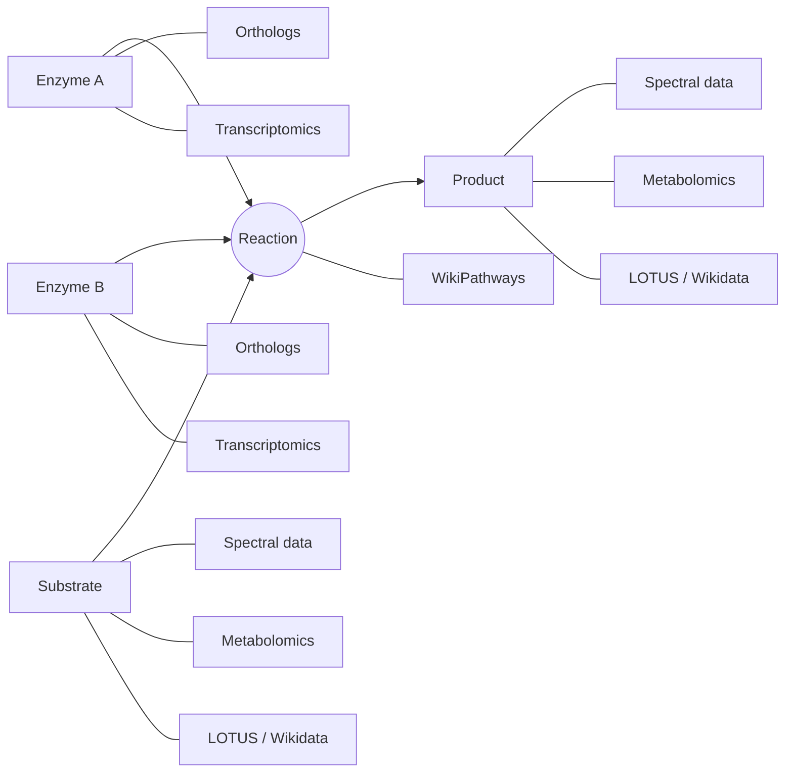

# LOD-pathways-community

This file serves as a reference for establishing a community of collaborators around a knowledge base to annotate pathway. 

## Collaborators 
- Elena Del Pup, Wageningen University, elena.delpup@wur.nl
- Marnix Medema 
- Justin van der Hoooft
- Mitja Zdouc
- Tito Damiani
- Adriano Rutz
- Pierre-Marie Allard
- Denise Slenter
- Egon Willighagen
- Louis Felix Nothias
- Daniel Probst 

## Other potential collaborators 
- 

## Mermaid plot for rendering of the knowledge graph 

