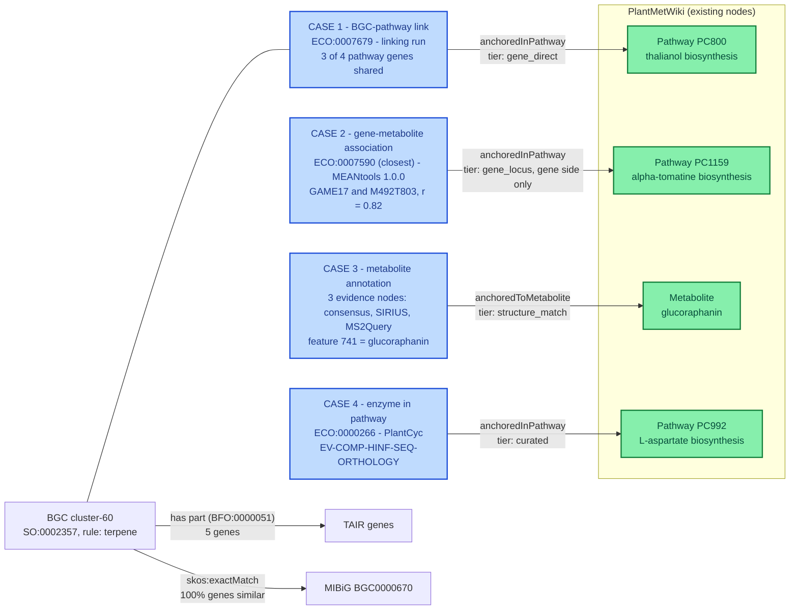

# Example: a sample evidence graph and a query over it

This folder shows, in a small and complete example, how predictions from the different use cases are attached to PlantMetWiki nodes with the same pattern. It is meant for readers who want to see what the shape constraints and the specification produce, before looking at the generated data of the pilots.

| File | What it is |
|---|---|
| [`sample_evidence_graph.ttl`](sample_evidence_graph.ttl) | One real claim from each of four use cases (BGC, paired omics, MS/MS consensus annotation, PlantCyc), written in RDF (Turtle) with its evidence and the tool run behind it. Identifiers and numbers come from the [pilots](../pilots/) and from the PlantMetWiki SPARQL endpoint (snapshot 2026-09-29), so nothing in it is a new biological claim. The `lodp:` namespace is a placeholder for terms that no ontology provides ([`vocab/lodp.ttl`](../shape_constraints/vocab/lodp.ttl), discussed in the [specification](../specification/SPECIFICATION.md)). The graph conforms to the [shape constraints](../shape_constraints/) with 0 violations and 1 warning (the non-significant cluster of the paired-omics claim). |
| [`claims_by_evidence.rq`](claims_by_evidence.rq) | A SPARQL query (a question asked to RDF data) that lists every claim with the PlantMetWiki pathway or metabolite it is attached to, how strong that attachment is, and the evidence types and tools behind it. One query serves all use cases because they share the same pattern. |

Check the graph against the shapes:

```bash
cd ../shape_constraints
.venv/bin/python validate.py ../examples/sample_evidence_graph.ttl
```

## The pattern

Every claim has the same skeleton: `claim → sio:SIO_000772 (has evidence) → evidence node typed with an ECO class → prov:wasGeneratedBy → run (software, version, input data)`, plus tool-specific scores on the evidence node. The claim is attached to PlantMetWiki with `lodp:anchoredInPathway` or `lodp:anchoredToMetabolite`, and `lodp:anchorTier` says how strong that anchor is (`curated`, `gene_direct`, `gene_locus`, `structure_match`, `gene_uniprot`, `gene_ec`, `mass_match`, strongest first). The shapes accept weak anchors but flag them.

The four claims come from different species and datasets, so they meet in the *pattern*, not in one pathway:



## What the sample graph shows

- **Case 1, the BGC.** `cluster-60` is a plantiSMASH terpene BGC in *A. thaliana* with a complete MIBiG match (thalianol, `BGC0000670`, 100% of genes similar). It shares 3 of the 4 TAIR genes of *thalianol and derivatives biosynthesis*. The BGC is *predicted* by plantiSMASH, but its link to the pathway is made by our mapping, so the link's evidence comes from a separate **linking run** that lists both inputs. The same three genes also link the cluster to *heme degradation I* (PC687), so a link needs to record *which genes* link it and should be checked for chemistry before it is shown as a fact.
- **Case 2, the association.** GAME17 is a gene that PlantMetWiki already lists in α-tomatine biosynthesis, and its correlation with the feature is strong (r = 0.82, p = 3×10⁻⁵). But its cluster is not significant (p = 0.75), and the metabolite is not identified. The graph therefore anchors the association on the **gene side only** and says so (`lodp:anchoredSide`); the shapes flag the cluster as a warning. PlantMetWiki support can be partial.
- **Case 3, the annotation.** One claim with three evidence nodes, one per tier: the consensus (SIRIUS and MS2Query agree, `match_type = partial`, score 0.5), SIRIUS and MS2Query. The claim is anchored to the PlantMetWiki **metabolite**, not to its pathways: anchoring to every pathway of a metabolite is noisy (glutathione occurs in 106 pathway entries), and the pathways are reachable through the metabolite.
- **Case 4, PlantCyc.** The `EV-COMP-HINF-SEQ-ORTHOLOGY` code is stored in PlantMetWiki as a citation property of the enzyme node. The graph reads it as evidence for the node's membership in the pathway. This interpretation should be confirmed with the PlantCyc curators.
- **Validation.** The graph passes the [shapes](../shape_constraints/) with 0 violations and 1 warning (the non-significant cluster of case 2).

## One query over all claims

[`claims_by_evidence.rq`](claims_by_evidence.rq):

```sparql
PREFIX lodp: <https://example.org/lod-pathways/pilot/>
PREFIX sio:  <http://semanticscience.org/resource/>
PREFIX prov: <http://www.w3.org/ns/prov#>
PREFIX rdfs: <http://www.w3.org/2000/01/rdf-schema#>

SELECT ?claim ?anchor ?anchorTier
       (GROUP_CONCAT(DISTINCT STRAFTER(STR(?evidenceType), "obo/"); separator=", ") AS ?evidenceTypes)
       (GROUP_CONCAT(DISTINCT ?tool; separator=", ") AS ?tools)
WHERE {
  ?claim (lodp:anchoredInPathway | lodp:anchoredToMetabolite) ?a ;
         lodp:anchorTier ?anchorTier ;
         sio:SIO_000772 ?ev .
  ?a rdfs:label ?anchor .
  ?ev a ?evidenceType ;
      prov:wasGeneratedBy/lodp:software ?tool .
  FILTER(STRSTARTS(STR(?evidenceType), "http://purl.obolibrary.org/obo/ECO_"))
}
GROUP BY ?claim ?anchor ?anchorTier
ORDER BY ?anchor
```

Run on the sample graph (checked with rdflib), it returns one row per claim:

| Claim | Anchor | Anchor tier | Evidence classes | Tools |
|---|---|---|---|---|
| enzyme node `GDQC_108527_MONOMER` (case 4) | L-aspartate biosynthesis | `curated` | `ECO:0000266` | PlantCyc |
| annotation of feature pos 741 (case 3) | glucoraphanin | `structure_match` | `ECO:0007653`, `ECO:0001580`, `ECO:0007669` | Consensus_annotator, SIRIUS, MS2Query |
| BGC-pathway link, cluster-60 (case 1) | thalianol and derivatives biosynthesis | `gene_direct` | `ECO:0007679` | the linking run |
| GAME17 and M492T803 (case 2) | α-tomatine biosynthesis | `gene_locus` | `ECO:0007590` | MEANtools |
