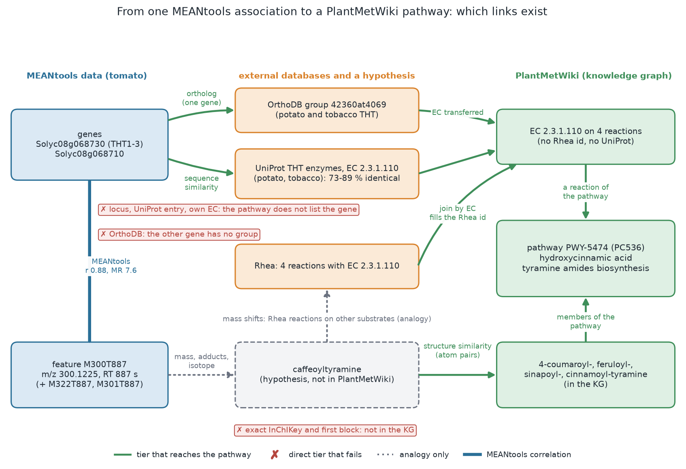
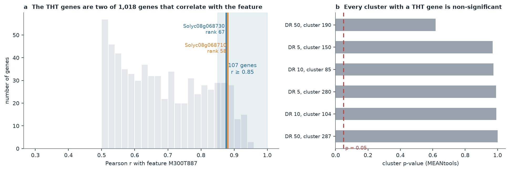
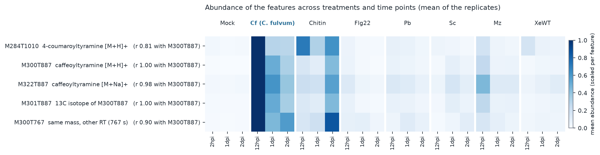
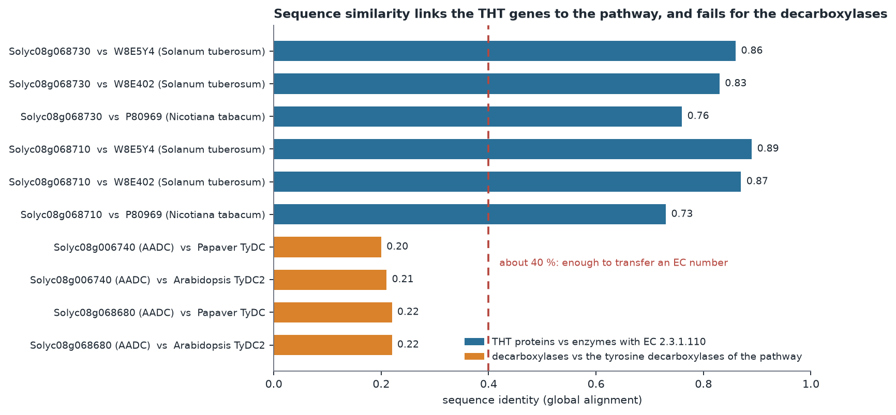
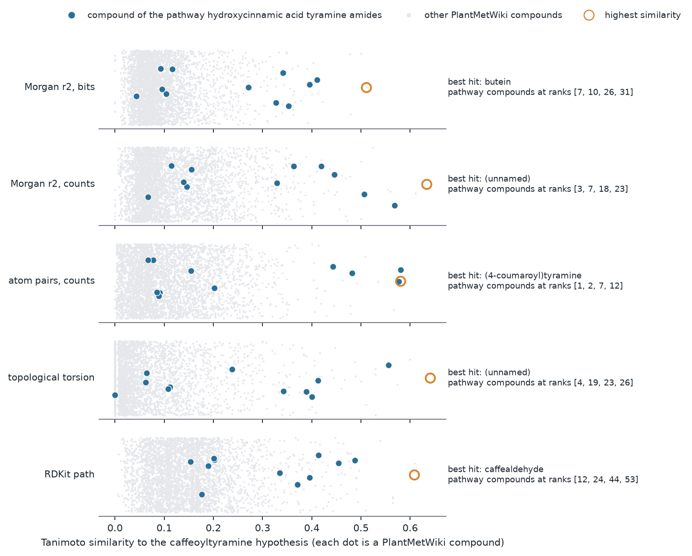
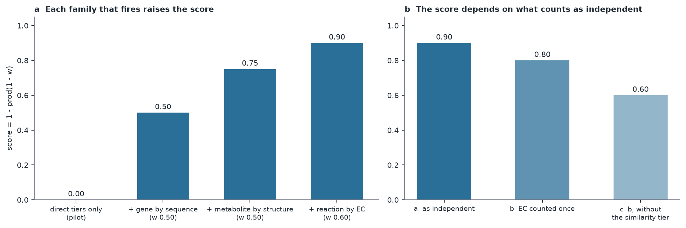
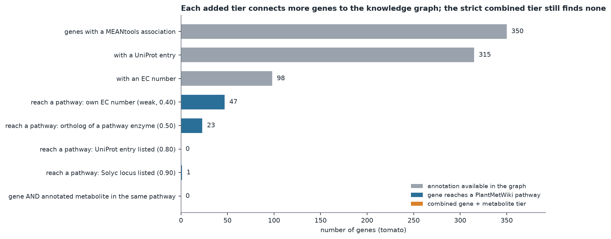
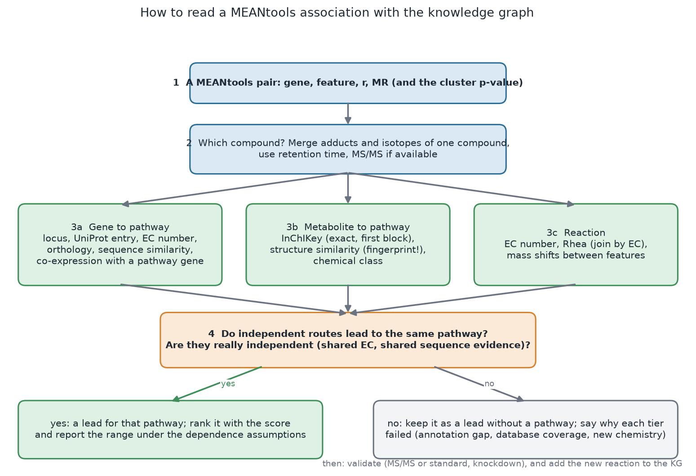

# The MEANtools use case: what the knowledge graph and broader evidence tiers add

**In one sentence.** A MEANtools correlation says that a gene and a metabolite feature move together; connecting the gene, the feature and the reaction to PlantMetWiki through several evidence tiers says **whether that movement is biochemically explainable, by which route, and how far to trust it**. The direct tiers alone (locus, UniProt, EC, exact InChIKey) found nothing in this dataset; the broader tiers found the right pathway from three independent sides.

This page summarises the worked example in [`notebooks/06_meantools_tht_example.ipynb`](notebooks/06_meantools_tht_example.ipynb) (all numbers and figures come from there) and what it means for the [minimum information tiers](README.md) and the [score](scoring.md).

## 1. The question

[MEANtools](https://journals.plos.org/plosbiology/article?id=10.1371/journal.pbio.3003307) combines transcriptomics and metabolomics and reports gene-feature correlations with a mutual rank (MR) and functional clusters. In the tomato case study (leaves treated with *Cladosporium fulvum* and other elicitors) it keeps 121,043 gene-feature pairs for 5,380 genes and 138 features.

The first pilot ([`pairedomics_overlap`](../pilots/pairedomics_overlap/)) mapped genes and features to PlantMetWiki directly and found **0 of 721 fully mapped pairs that share a pathway** (about 5 expected by chance). Does that mean the correlations carry no pathway information, or that the direct mapping is too strict? The example below tests this on one association that biology says should be in a pathway.

## 2. The example

The genes `Solyc08g068730` (THT1-3) and `Solyc08g068710` code for putative **tyramine hydroxycinnamoyl transferases (THT)**, the enzymes of the PlantMetWiki pathway *hydroxycinnamic acid tyramine amides biosynthesis* (PlantCyc PWY-5474, PC536 in release r17). They correlate (r 0.88, MR 7.6) with feature `M300T887`, m/z 300.1225, which fits **caffeoyltyramine**, a compound that is **not** in PlantMetWiki.

A one-page summary of the claim, the evidence and the avenues is in the [claim card](cards/tht_caffeoyltyramine_card.html) ([PNG](cards/tht_caffeoyltyramine_card.png)).

*Solid green: tiers that reach the pathway. Red ✗: direct tiers that fail. Dotted: analogy only.*

## 3. What each step shows

**The correlation alone is a lead, not an answer.** The THT genes are two of 1,018 genes that correlate with this feature (rank 58 and 67; 107 genes have r ≥ 0.85), and both sit in functional clusters that are **not significant** (cluster p 0.62 to 1.0). The cluster statistic would have discarded the pair; the pair statistic keeps it. Neither says what the gene does.

**The feature is one compound, seen three times.** The [M+H]+ and [M+Na]+ adducts and the 13C isotope of the compound co-vary almost perfectly across 24 conditions (r 0.98 to 1.00) and respond most to *C. fulvum* at 12 hpi. Counted as separate features they inflate the number of associations, and the isotope received a false identity (salidroside, guanosine) in the mass-only mapping of the pilot.

**Gene side.** The three direct tiers fail for a reason that is about annotation, not biology: PlantMetWiki lists the THT step by EC number only (2.3.1.110, no UniProt enzyme), and the tomato THT proteins are unreviewed entries without an EC number. **Orthology** (OrthoDB) works for `Solyc08g068710` and not for `Solyc08g068730`, which has no group. **Sequence similarity** to enzymes that carry EC 2.3.1.110 works for both (73 to 89 % identity) and transfers the EC to the pathway. A decarboxylase that correlates just as strongly (r 0.89) cannot be linked by sequence (about 20 % identity), so the rule misses a true signal.

**Metabolite side.** The exact InChIKey and the first block are not in PlantMetWiki. **Chemical similarity** can retrieve the pathway, but only if the fingerprint is chosen well: with Morgan bits the nearest compounds are chalcones (the pathway compounds come at rank 7 and 10), with atom-pair counts the first two are the pathway's own amides. A similarity tier needs a fixed fingerprint, a threshold and a rule that aggregates by pathway, decided **before** calibration.

**Reaction side.** PlantMetWiki has the four THT reactions with EC 2.3.1.110 and **no Rhea id**; Rhea has four reactions for the same EC. Joining on the EC fills the gap. There is no Rhea reaction for caffeoyl-CoA with tyramine, so the compound is connected to its relatives only by mass shifts (analogy), and may be a **reaction missing from both resources**.

**Score.** The three families that fire (gene by sequence, metabolite by structure, reaction by EC) give 0.90 against 0 for the direct tiers. The tiers are not fully independent (the gene and the reaction tiers share the same EC number), so counting the EC once gives 0.80, and without the similarity tier 0.60. The honest answer is a **range**; narrowing it is the job of the calibration.

## 4. Beyond one example: the whole dataset

The same chain, counted for all genes of the associations: 315 of 350 genes have a UniProt entry, 98 an EC number; **47 genes reach a pathway through their EC number, 23 through an ortholog of a pathway enzyme**, and 1 (GAME17 of α-tomatine) by locus. The strict combined tier (gene **and** annotated metabolite in the same pathway) still finds none, as in the pilot.

**Outside the significant clusters.** The 350 genes are those of the clustered associations; the THT genes are not among them. For all 5,380 correlated genes (`funnel_all_genes.py`, with an EC transferred by sequence similarity through UniRef50): 4,776 have a UniProt entry, 1,035 an EC of their own and 1,457 a transferred EC; 409 reach a pathway by own EC, 688 by transferred EC, 238 by ortholog, 2 by UniProt entry and 16 by locus. **Both THT genes are reached only by the transferred EC.** The strict combined tier now finds 7 genes (8 pairs) against 1.9 expected from a shuffled annotation (p = 0.003), but the hits rest on mass-only annotations (for example "catharanthine" or "norbelladine" in tomato) and on orthology, so they need checking before they count as evidence.

So the zero of the first pilot was mostly an **annotation gap**: the evidence is there, but only broader tiers can see it, and they must be read with their weights and their dependence.

## 4b. From a link to a putative reaction (ghost edge)

The graph can also propose a **new reaction inside the pathway**, not only a pathway label. For the THT example ([`putative_reaction.py`](../pilots/pairedomics_overlap/putative_reaction.py), output `results/putative_reaction_tht.json`):

1. **Template.** PlantMetWiki has four reactions with EC 2.3.1.110 in PWY-5474: *cinnamoyl-, p-coumaroyl-, feruloyl-, sinapoyl-CoA + tyramine => amide + CoA*. The caffeoyl member of the series is missing.
2. **Mass link.** The feature M300T887 (neutral mass 299.1152) is 15.994 above p-coumaroyltyramine (+O) and 14.016 below feruloyltyramine (-CH2).
3. **Proposed reaction.** *caffeoyl-CoA + tyramine => caffeoyltyramine + CoA* (EC 2.3.1.110). Checks: caffeoyltyramine C17H17NO4 gives [M+H]+ 300.1230 (1.9 ppm from the feature); the implied acid (180.0417) is caffeic acid (3.2 ppm); the equation is balanced (C38H53N8O20P3S on both sides); **caffeoyl-CoA and caffeate are in PlantMetWiki**; Rhea has the four neighbouring reactions for the EC and **none with caffeoyl**.

How specific is step 3's mass inference? A random mass finds a PlantMetWiki compound as the implied acid in 0.9 % of cases; 41 of 1,131 features (3.6 %) do, so it is selective but not unique. The reaction is a **hypothesis** that needs a standard or MS/MS; the gene side (THT genes) supports the enzyme class but not the substrate specificity.

## 5. How to read a MEANtools association

1. **A correlation is a lead, not a pathway.** Look at the pair (r, MR) first and at the cluster second; a significant cluster can be a respiration module, and a non-significant one can hold a real enzyme-product pair.
2. **Count compounds, not peaks.** Merge adducts and isotopes before counting and before mapping by mass.
3. **Zero overlap is usually an annotation gap.** Use the broader tiers (sequence, orthology, similarity, EC to Rhea) to bridge it, and report which bridge was used.
4. **Agreement of independent routes is the evidence**, but check that the routes are really independent (shared EC, shared sequence evidence).
5. **Report why a tier fails** (database coverage, pathway lists another enzyme, new chemistry, fingerprint choice). A failure is a statement about a resource, not about the biology.
6. **Match pathways by PlantCyc id**, not by the PC number (PC712 in the pilot snapshot is PC536 in r17).

## 6. What it means for the standard and the graphs

| For | What the example asks |
|---|---|
| **Data providers** (MEANtools users) | Give each feature m/z, adduct, retention time and a compound group for its adducts and isotopes; give genes with a UniProt accession as well as the locus; report pair-level statistics, not only cluster p-values. |
| **PlantMetWiki** | List a UniProt enzyme or ortholog for steps given by EC only; add Rhea ids by joining on the EC (four THT reactions here); keep PlantCyc ids as the stable key across releases. |
| **The minimum information model** | Keep the tiers as queries with their weights and families; record, per claim, which tiers passed **and why the others failed**; allow a "lead without a pathway" state; fix fingerprint, threshold and identity cut-off before calibration. |
| **The scoring** | Report a range under explicit dependence assumptions; calibrate on held-out validated pathways, a shuffled null and a positive control (the ipecac pilot). |

## 7. Limits

One compound and one pathway, identified at level 3-4 (mass, retention time and a plausible biochemical family; no MS/MS), with hand-written structures. The example **illustrates** the tiers and does not estimate how often they succeed. The masses are computed from hand-written structures; the hypothesis, caffeic acid and tyramine were cross-checked in PubChem (same InChIKey, same formula and exact mass) and ChEBI (notebook 06), which checks the structure and mass, not the identity of the feature. The fingerprint comparison was made knowing the answer. Weights, the sequence-identity cut-off (about 40 %) and the dependence assumptions are drafts. The supporting graphs (UniProt entries, ECs, OrthoDB orthologs) are lower bounds built from public sources on 2026-11-18.

## 8. Reproduce

- Notebook: [`notebooks/06_meantools_tht_example.ipynb`](notebooks/06_meantools_tht_example.ipynb) (needs the MEANtools database of the pilot, internet access, RDKit and Biopython; see [`notebooks/README.md`](notebooks/README.md)).
- Data of the pilot: [`pilots/pairedomics_overlap`](../pilots/pairedomics_overlap/) (MEANtools output, Zenodo 15697913; features and genes) and its supporting graphs `gene_annotation.ttl` and `feature_annotation.ttl`.
- Queries and tiers: [`sparql-examples-pmw`](https://github.com/pathway-lod/sparql-examples-pmw); how the score is computed: [`scoring.md`](scoring.md).
