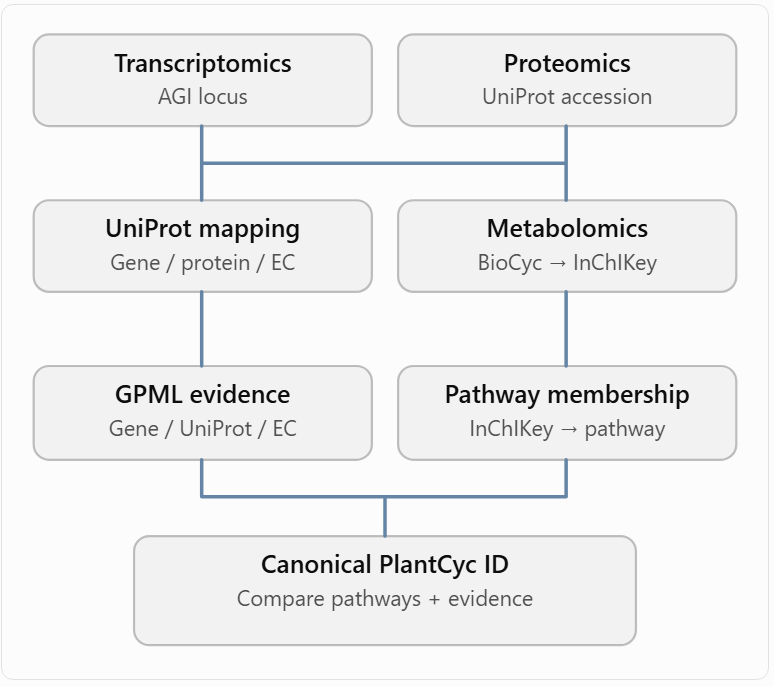

# Multi-Omics Evidence Integration: An *Arabidopsis* Heat-Stress Memory Case Study

**An ontology-oriented case study for representing computational evidence derived from paired transcriptomics, proteomics, and metabolomics data.**

## 1. Overview

This case study explores how computational evidence generated from multi-omics analyses can be represented using standardized ontology terms and linked to biological knowledge.

The study focuses on three molecular layers:

- **Transcriptomics** — gene expression measurements
- **Proteomics** — protein abundance measurements
- **Metabolomics** — metabolite abundance measurements

The primary objective is to investigate how associations between molecular entities across omics layers can be represented as structured, traceable evidence supporting biological assertions.

In particular, this case study explores:

1. Representation of experimental and computational evidence using the **Evidence and Conclusion Ontology (ECO)**.
2. Identification of statistical metrics supporting cross-omics associations.
3. Provenance tracking for data processing and statistical analyses.
4. Integration of molecular identifiers with existing biological knowledge resources.
5. Development of candidate evidence categories for multi-omics integration.

### Reference publication

Thirumalaikumar, V. P., Yu, L., Arora, D., et al. (2026). *Multi-Omics Dataset of Heat Stress-Induced Memory in Arabidopsis.* Scientific Data, 13, 1447.

**DOI:** https://doi.org/10.1038/s41597-026-07813-z

---

## 2. Experimental dataset

### 2.1 Biological context

**Organism:** *Arabidopsis thaliana*

**Biological process:** Heat-stress priming and stress memory

**Experimental design:** Heat-primed seedlings and corresponding controls, sampled during the recovery period.

Five-day-old seedlings were subjected to the following heat-stress regime:

| Step | Temperature | Duration |
|---|---|---|
| Initial heat treatment | 37 °C | 1.5 h |
| Recovery | 22 °C | 1.5 h |
| Second heat treatment | 44 °C | 45 min |

Samples were collected at four timepoints following heat-stress priming:

**Day 1 · Day 2 · Day 3 · Day 4**

The experimental design included four biological replicates, although the number of available samples can differ between datasets and analyses.

### 2.2 Data availability

| Omics layer | Data repository | Accession |
|---|---|---|
| Transcriptomics | NCBI SRA | [SRP589115](https://www.ncbi.nlm.nih.gov/sra/?term=SRP589115) |
| Proteomics | MassIVE | MSV000098061 |
| Metabolomics | MassIVE | MSV000098074 |

These datasets provide the experimental foundation for constructing computational evidence of molecular responses to heat-stress priming.

### 2.3 Sample pairing

The original publication provides measurements of different molecular layers from matched biological material.

For the present project, sample identifiers were harmonized across datasets to identify samples with measurements from all three omics layers.

**Final integrated dataset: 22 matched samples.**

Paired measurements establish sample correspondence, but do not themselves demonstrate associations between molecular entities.

---

## 3. Experimental methods reported in the original publication

This section describes the experimental and computational methods used to generate the original omics datasets.

These methods provide the provenance of the measurements used in subsequent evidence-generation analyses.

### 3.1 Transcriptomics

**Assay:** RNA sequencing (RNA-seq)

**Platform:** Illumina HiSeq 4000, 100 bp single-end reads

| Processing step | Software / method | Output |
|---|---|---|
| Read preprocessing | Trimmomatic v0.38 | Quality-filtered sequencing reads |
| Read alignment | HISAT2 | Reads aligned to the *Arabidopsis* reference genome |
| Gene quantification | featureCounts | Gene-level read counts |
| Differential expression analysis | DESeq2 | Differential gene expression statistics |

**Processing details:**

- Sequencing adapters and low-quality bases were removed.
- Reads shorter than 25 bp were discarded.
- Only uniquely mapped reads were retained.
- Gene-level counts were generated using featureCounts with `-t exon -g gene ID -s 0`.
- Gene expression analysis was performed using DESeq2.

### 3.2 Proteomics

**Assay:** Liquid chromatography–tandem mass spectrometry (LC-MS/MS)

**Platform:** Q-Exactive mass spectrometer coupled to EASY-nLC 1000

**Processing software:** Proteome Discoverer v2.5

| Processing step | Software / method | Output |
|---|---|---|
| Peptide identification | SEQUEST HT | Peptide-spectrum matches |
| Protein identification | Proteome Discoverer | Identified proteins |
| Protein quantification | Label-free quantification (LFQ) | Protein abundance estimates |
| Normalization | Proteome Discoverer | Normalized protein intensities |
| Transformation | Log2 transformation | Transformed protein abundance matrix |
| Missing-value handling | Distribution-based imputation | Imputed protein abundance matrix |

**Identification parameters:**

- Reference database: TAIR10 *Arabidopsis* protein database.
- Maximum missed cleavages: 2.
- Minimum peptide length: 6 amino acids.
- Precursor mass tolerance: 10 ppm.
- Fragment mass tolerance: 0.02 Da.
- Static modification: cysteine carbamidomethylation.
- Dynamic modification: methionine oxidation.
- Peptide-spectrum-match FDR thresholds: 0.01 (high confidence) and 0.05 (medium confidence).

Label-free protein quantification was based on MS1 precursor ion intensities using the Top 3N peptide approach.

### 3.3 Metabolomics

**Assay:** Untargeted gas chromatography–time-of-flight mass spectrometry (GC-TOF-MS)

| Processing step | Method / software | Output |
|---|---|---|
| Sample preparation | Methoxyamination and MSTFA derivatization | Derivatized metabolites |
| Metabolite detection | GC-TOF-MS | Chromatographic peaks and mass spectra |
| Peak processing | TargetSearch | Processed metabolite features |
| Compound annotation | TargetSearch | Annotated metabolites |

Metabolite identification and annotation provide the molecular identifiers required for connecting metabolite abundances to biochemical knowledge resources.

## Summary

| Method | Role in representation | Evidence type or outcome | Metric to capture |
|---|---|---|---|
| RNA-seq | Assay | Transcript abundance measurement | Read count, normalized abundance |
| HISAT2 | Processing activity | Read alignment | Mapping quality, mapped read count if available |
| featureCounts | Quantification activity | Gene abundance | Counts per gene |
| DESeq2 | Statistical inference | Differential expression | log2FC, p, adjusted p |
| LC-MS/MS | Assay | Peptide/protein detection | MS intensity, precursor information |
| SEQUEST HT | Identification activity | Peptide identification | PSM score, identification FDR |
| LFQ | Quantification activity | Protein abundance measurement | Normalized intensity |
| GC-TOF-MS | Assay | Metabolite feature detection | Peak area/intensity |
| TargetSearch | Annotation activity | Putative metabolite identity | Annotation identifier and score, if available |
| Student's t-test | Statistical inference | Differential abundance | p-value, group difference |

---

## 4. Additional data processing performed in this project

The following analyses were performed specifically for this case study and must be distinguished from the processing reported in the original publication.

### 4.1 Sample harmonization

Sample identifiers were standardized across transcriptomics, proteomics, and metabolomics datasets.

Only samples represented in all three layers were retained.

**Number of matched samples: 22**

### 4.2 Omics-specific preprocessing

| Omics layer | Processing step | Method / software |
|---|---|---|
| Transcriptomics | Low-expression filtering | `filterByExpr`, edgeR |
| Transcriptomics | Normalization | DESeq2 |
| Transcriptomics | Variance-stabilizing transformation | DESeq2 VST |
| Proteomics | Missing-data filtering | Retain proteins measured in at least 20 samples |
| Proteomics | Normalization | Central median normalization |
| Proteomics | Transformation | Log2 transformation |
| Metabolomics | Transformation | Log2 transformation |
| Metabolomics | Identifier harmonization | Metabolite Translation Service / BioCyc |

The resulting normalized abundance matrices serve as inputs to statistical analysis and cross-omics association inference.

### 4.3 Differential abundance analysis

Differential gene expression and differential protein abundance analyses were conducted using:

- **Transcriptomics:** DESeq2
- **Proteomics:** limma

The statistical design was:

`~ TIME + TREATMENT`

This model estimates timepoint and treatment effects, assuming additive effects without a time–treatment interaction.

**Feature selection criteria:**

| Omics layer | Statistical criterion | Effect-size criterion |
|---|---|---|
| Transcriptomics | Adjusted p-value < 0.05 | Absolute log2 fold change > 1.5 |
| Proteomics | Adjusted p-value < 0.05 | Not specified |
| Metabolomics | No differential-abundance selection threshold specified | — |

Significant transcript and protein features were selected for subsequent cross-omics association analyses.

---

## 5. Cross-omics association analysis

### 5.1 Objective

The objective is to identify statistically supported associations between molecular entities measured in different omics layers.

The following relationships are considered:

- **Transcript ↔ Metabolite**
- **Protein ↔ Metabolite**

These associations may provide computational evidence for coordinated molecular responses to heat-stress priming.

However, statistical association does not directly establish a regulatory, catalytic, or causal relationship.

### 5.2 Association methods

| Method | Input | Output metric | Interpretation |
|---|---|---|---|
| Pearson correlation | Paired molecular abundances | Pearson r | Linear association |
| Spearman correlation | Paired molecular abundances | Spearman ρ | Monotonic association |

**Pearson correlation** quantifies linear relationships between normalized molecular abundance profiles.

**Spearman correlation** quantifies monotonic associations based on abundance ranks.

Both methods generate pairwise association statistics that can be represented as computational evidence supporting relationships between molecular entities.

### 5.3 Statistical evidence metrics

| Metric | Description | Role in evidence representation |
|---|---|---|
| Pearson r | Linear correlation coefficient | Association strength and direction |
| Spearman ρ | Rank-based correlation coefficient | Monotonic association strength and direction |
| p-value | Statistical significance measure | Evidence against the null hypothesis |
| Adjusted p-value | Multiple-testing-adjusted significance | Statistical support after correction |

Each association should be represented as an individual computational evidence record containing the method, metric values, molecular participants, and provenance.

---

## 6. Integration with biological knowledge

Molecular identifiers and inferred associations are compared against existing entries in **PlantMetWiki**.

The aim is to investigate whether computationally inferred relationships correspond to existing biological knowledge and identify potentially novel associations.

### Identifier mapping

| Molecular layer | Identifier type | Intended use |
|---|---|---|
| Transcriptomics | *Arabidopsis* gene identifiers | Gene-level entity mapping |
| Proteomics | Protein / gene identifiers | Protein–gene correspondence |
| Metabolomics | Compound identifiers, InChIKey | Chemical entity mapping |
| Knowledge resource | PlantMetWiki identifiers | Existing biological associations |

Chemical identifier mapping should distinguish exact chemical matches from ambiguous or partial matches.

### Knowledge comparison

The evidence integration workflow should distinguish:

1. **Previously represented relationships** — inferred associations that correspond to existing knowledge.
2. **Potentially novel relationships** — inferred associations not represented in the queried resource.
3. **Unresolved mappings** — associations for which one or more molecular entities cannot be mapped unambiguously.

An association absent from PlantMetWiki is not necessarily biologically novel; it may be missing from that resource.

### Evidence integration overview

---

## 7. Ontology-oriented evidence representation

### 7.1 Conceptual model

The proposed representation separates four components:

| Component | Description | Example |
|---|---|---|
| Biological assertion | A claim about a molecular entity or relationship | Transcript abundance is associated with metabolite abundance |
| Evidence type | Classification of evidence supporting the assertion | Cross-omics abundance association evidence |
| Evidence-generating activity | Computational procedure used to generate evidence | Pearson correlation analysis |
| Evidence metrics | Quantitative values describing the result | Correlation coefficient, p-value, adjusted p-value |

This separation is important for keeping biological assertions distinct from the methods and numerical measurements used to support them.

### 7.2 Relevant ontologies and standards

| Ontology / standard | Intended role |
|---|---|
| Evidence and Conclusion Ontology (ECO) | Classification of evidence supporting biological assertions |
| Statistical Methods Ontology (STATO) | Representation of statistical methods and statistics |
| Ontology for Biomedical Investigations (OBI) | Representation of assays and experimental investigations |
| PROV-O | Provenance of datasets, computational activities, and generated results |
| Gene Ontology (GO) | Biological processes, molecular functions, and cellular components |
| ChEBI | Standardized chemical entity identifiers |

Existing ontology terms should be reused wherever they adequately represent the intended concepts.

### 7.3 Candidate ECO evidence categories

The following categories are conceptual proposals for representing multi-omics evidence. They are not asserted to be existing ECO classes.

| Priority | Proposed evidence category | Intended scope |
|---|---|---|
| 1 | Cross-omics abundance association evidence | Statistical associations between features from different omics layers |
| 2 | Cross-omics latent-factor association evidence | Associations inferred through shared latent factors |
| 3 | Cross-omics network/module membership evidence | Relationships inferred from shared network or module membership |
| 4 | Cross-omics pathway integration evidence | Support derived from integration at the pathway level |
| 5 | Reaction-rule-supported multi-omics evidence | Support for putative biochemical transformations or pathways |

The primary candidate for this case study is **cross-omics abundance association evidence**.

### 7.4 Proposed evidence term

**Preferred label:** Cross-omics abundance association evidence

**Proposed definition:**

> A type of computational evidence derived from statistical analysis of molecular abundance measurements from distinct omics modalities, in which an association between molecular features is inferred from their abundance patterns across matched biological samples.

**Potential synonyms:**

- Inter-omics abundance association evidence
- Multi-omics molecular abundance association evidence

This term is intended to describe the nature of evidence rather than a particular statistical method or software implementation.

Pearson correlation, Spearman correlation, and other association methods could therefore generate evidence classified under the same broader category.

### 7.5 Evidence record requirements

A computational evidence record should include:

| Property | Description |
|---|---|
| Evidence identifier | Unique identifier of the evidence record |
| Evidence type | ECO classification |
| Supported assertion | Biological relationship supported by the evidence |
| Subject entity | First molecular participant |
| Object entity | Second molecular participant |
| Omics modalities | Molecular layers used in the analysis |
| Statistical method | Method generating the association |
| Association score | Correlation coefficient or other association metric |
| Statistical significance | p-value and/or adjusted p-value |
| Sample context | Matched sample set, sample count, conditions, timepoints |
| Data provenance | Input datasets and processing steps |
| Software provenance | Software, version, parameters |
| Publication provenance | DOI or associated publication |

The evidence record should preserve the distinction between the **observed association** and any downstream interpretation of its biological mechanism.

---

## 8. Evidence versus biological interpretation

The strength and meaning of a biological claim depend on the type of evidence used to support it.

| Observation or result | Potential supported assertion | Limitation |
|---|---|---|
| Significant differential transcript abundance | Gene expression changes under heat-stress priming | Does not imply a corresponding protein change |
| Significant differential protein abundance | Protein abundance changes under treatment | Does not directly establish enzymatic activity |
| Significant transcript–metabolite correlation | Transcript and metabolite abundances are associated | Does not establish metabolic regulation |
| Significant protein–metabolite correlation | Protein and metabolite abundances are associated | Does not establish substrate–enzyme relationships |
| Agreement with existing PlantMetWiki knowledge | Association is consistent with a known relationship | Does not independently validate causality |

This distinction is essential for preventing statistical associations from being interpreted automatically as mechanistic biological relationships.

---

## References

1. Thirumalaikumar, V. P., Yu, L., Arora, D., et al. (2026). *Multi-Omics Dataset of Heat Stress-Induced Memory in Arabidopsis.* Scientific Data, 13, 1447. https://doi.org/10.1038/s41597-026-07813-z
2. [Evidence and Conclusion Ontology (ECO)](https://www.evidenceontology.org/)
3. [Statistical Methods Ontology (STATO)](https://www.ebi.ac.uk/ols4/ontologies/stato)
4. [Ontology for Biomedical Investigations (OBI)](https://obi-ontology.org/)
5. [PROV-O: The PROV Ontology](https://www.w3.org/TR/prov-o/)
6. [Chemical Entities of Biological Interest (ChEBI)](https://www.ebi.ac.uk/chebi/)
