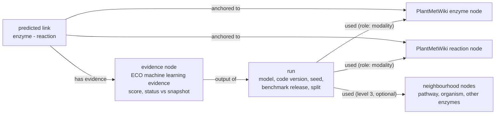

# Pilot (planned): unsupervised predictions (link prediction) vs PlantMetWiki

How can the predictions of a machine-learning model that was trained and tested on PlantMetWiki itself be written as evidence and attached to the PlantMetWiki nodes they are about?

This pilot belongs to the UN use case (*unsupervised predictions*) of the [specification](../../specification/SPECIFICATION.md) (UN-01 to UN-12); see also the [pipeline](../../README.md#the-pipeline). It has no code yet: this README describes the test data and proposes how to align it.

## Test data: PlantMetBench

[PlantMetBench: a multimodal knowledge graph benchmark for biosynthesis prediction](https://doi.org/10.26434/chemrxiv.15011165/v1) (Del Pup, Inal, Tirana, Escrig Molina, Xu, Potze, van der Hooft, Medema, Probst; ChemRxiv preprint, 27 October 2026), as described in its abstract:

- It is built on PlantMetWiki (424 organisms) and contains 13,682 proteins, 2,741 genes, 4,577 metabolites and 11,980 experimentally curated enzyme-reaction pairs.
- The task is **enzyme-reaction link prediction**. The split is **organism-disjoint**: the organisms of the test pairs are not in the training graph.
- The benchmark provides graph-native splits, precomputed multimodal node features and rank-based evaluation protocols.
- Heterogeneous graph neural networks (HeteroSAGE, GAT, HGT, R-GCN and variants) are compared with non-graph models. The preprint states that code and data are public (the locations still have to be added here).

Because the nodes of the benchmark graph are PlantMetWiki nodes, this is the case where the *two end nodes of a prediction already exist* in the knowledge graph (UN-01), which makes the alignment simpler than for the other use cases.

## What is to be recorded

| Piece | Specification | Source in the benchmark |
|---|---|---|
| A predicted link between two existing PlantMetWiki nodes (enzyme, reaction) | UN-01 | ranked candidate pairs of a model |
| Evidence: a machine-learning model predicted the link | UN-02 (ECO machine learning / deep learning evidence) | the model run |
| Model type and architecture | UN-03 | e.g. HeteroSAGE, HGT, a dual encoder |
| Supervised training on known links | UN-04 | the benchmark training procedure |
| Code version, hyperparameters, random seed | UN-05 | the run |
| Prediction score | UN-06 | score or rank of the pair |
| Performance on the benchmark | UN-07, UN-08 | the rank-based metrics of the preprint |
| Data split strategy | UN-09 (organism-held-out) | the split |
| Input modalities and edge types | UN-10 | the node features of each model |
| Benchmark dataset and version | UN-11 | PlantMetBench release and the PlantMetWiki snapshot it was built from |
| Predicted link told apart from curated link | UN-12 | see below |

## How to align the predictions with PlantMetWiki

1. **Map the benchmark identifiers to PlantMetWiki IRIs.** Each protein, gene, metabolite and reaction of the benchmark needs the IRI of its PlantMetWiki node. This is the anchor of the claim. Without a mapping table (benchmark ID to IRI, with the PlantMetWiki snapshot date) nothing else can be done.
2. **Give every predicted pair a status relative to PlantMetWiki.** The benchmark splits PlantMetWiki into training and test, so the pairs of a model's ranking fall into three groups:

   | Group | Meaning | Use as evidence |
   |---|---|---|
   | training pair | curated, seen by the model | none (it is the curated link) |
   | held-out test pair | curated, hidden from the model, in an organism that was held out | **retrospective validation** of the model: it counts in UN-07/UN-08, not as a new claim |
   | pair not in PlantMetWiki | not curated in any organism | a **new claim** (UN-01); the evidence is the model and its score |

   This is the answer to UN-12 for this case: the end nodes are curated, but the link has the status "predicted", and the status of the pair against the snapshot (training, held-out, not curated) is stored with it. The anchor tier "curated" must not be given to the link.
3. **Keep the validation and the claims apart.** The metrics on the held-out pairs are properties of the *model run* (how well this model finds known links in unseen organisms). The score of a *new* claim is a property of the *prediction*. A score is a rank-model output; whether it is a calibrated probability has to be stated per model (UN-06).
4. **Record the run with PROV-O** as in the rest of the specification: the claim has an evidence node typed with ECO; the evidence node is the output of a run that used the model, the code version, the seed, the dataset release and the split.
5. **Close the loop when PlantMetWiki grows.** The benchmark is a snapshot. When a new PlantMetWiki release curates a link that an earlier model had predicted, the prediction can be marked as confirmed. This gives a prospective validation that the held-out split cannot give.

## Linking a prediction to the nodes the model used

A prediction is a statement about two nodes, but the model used more than those two. What it used depends on the architecture:

- A **dual encoder** embeds the two sides separately (for example the protein and the reaction or metabolite, each from its own modality) and scores their similarity. It uses **two modalities and the two end nodes** and nothing else, so the used nodes are the endpoints.
- A **graph neural network** also uses the neighbourhood of both nodes (other proteins of the organism, metabolites of the reaction, pathways, organisms) through message passing. It uses **more node types and more modalities**.
- Models with further inputs (sequence, structure, text, chemical fingerprints, organism or pathway context) use more still.

Three levels of detail are possible, from cheap to expensive:

| Level | What is recorded | Cost | Specification |
|---|---|---|---|
| 1. Model | which modalities and edge types the model reads, per node type | one record per model run | UN-10 |
| 2. Prediction, endpoints | the two end nodes and the modality of each (`prov:used`, with a role) | one extra link per prediction | new term for the role |
| 3. Prediction, context | the nodes of the neighbourhood that the model used, or the ones that contributed most (for example from a graph explainer such as GNNExplainer) | large for many predictions; explainers are approximate | new terms |

A suggestion: store level 1 for every run, level 2 for every claim, and level 3 only for the top-ranked claims that someone wants to review. With level 2 or 3, a user can ask which curated nodes a prediction depended on, and a curator can see whether it rests on one modality or on several. It also makes models comparable on a common footing: the same pair predicted by a dual encoder and by a graph neural network is recorded with different `used` nodes.

## Open questions and what is missing

1. **The benchmark ID to PlantMetWiki IRI table** and the snapshot date of the benchmark.
2. **Where the code, the splits, the node features and the predictions of the models are published**, and whether the ranked predictions (not only the metrics) are saved.
3. **Terms** (all gaps in the specification): rank-based metrics such as the precision of the top k (UN-08), the split strategy (UN-09), modalities and edge types (UN-10), the status of a link relative to a snapshot (UN-12), and the role of a used node in a run (new).
4. **The title of the UN section.** Link prediction is trained on known links, so "Unsupervised predictions" may need rewording (UN-04, already noted).
5. **Which predictions become claims.** A threshold or a top-k per organism has to be decided, as a prediction list is much longer than the list of claims worth reviewing.

## Planned steps

1. Add the access to PlantMetBench (data and code) and the mapping to PlantMetWiki IRIs.
2. Take one trained model (for example a dual encoder) and one graph neural network, and the ranked pairs of the test organisms.
3. Classify the pairs (training, held-out, not curated) and write the RDF of the evidence for a small sample, at level 1 and 2.
4. Validate with the shapes in [`shape_constraints/`](../../shape_constraints/) and add the missing terms to the [specification](../../specification/) through the dashboard.
5. Test level 3 on the top-ranked claims of one organism.
