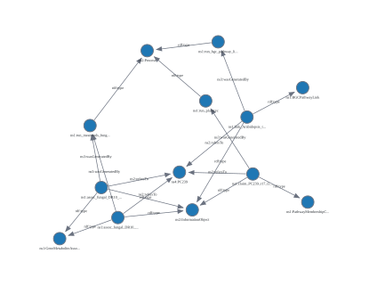
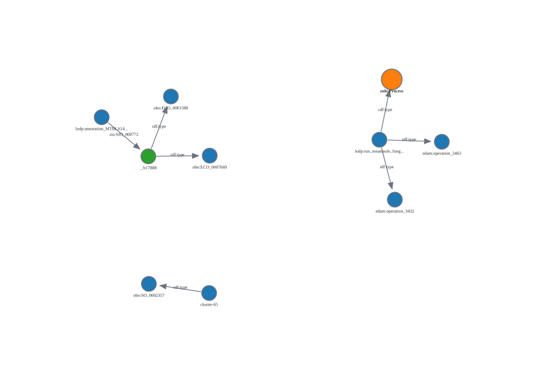
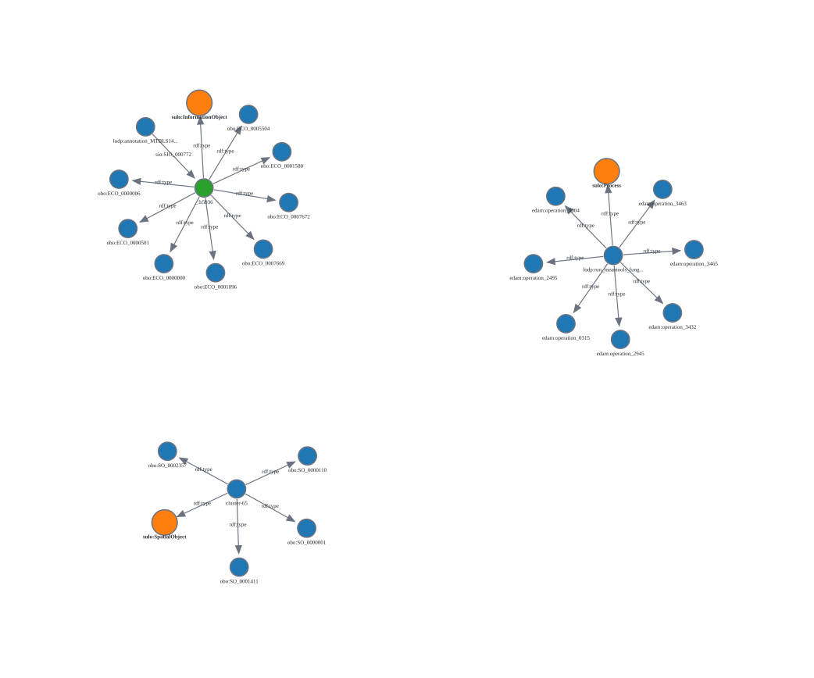

# Aligning the lodp: vocabulary with SULO

**In one sentence**: The project's own vocabulary (`lodp`) and the class that we share from other ontologies (ECO, SO, EDAM) get a place in SULO, a shared upper level ontology, so that people and programs outside the project can understand what our terms are. The validation checks written prove that this is consistent with SULO and with all the pilot data. An analysis also shows where our data does not fit SULO *yet*.

**`vocab/lodp.ttl` and the pilot data are not changed. The work lies in `shape_constraints/sulo_alignment` directory.**

## Outcome
- All 14 `lodp:` classes and 5/8 `object properties` now have `SULO parent`.

lodp | SULO parent
--- | ---
`Claim` and its 4 sub classes| `sulo:InformationObject`
`MetaboliteFeature`, `Mass2Motif` | `sulo:InformationObject`
`run` (and its 6 subclasses) | `sulo:Process`
`anchoredInPathway`, `anchoredToMetabolite`, `feature` | `sulo:refersTo`
`dataset` | `sulo:isItemIn`
`mibigMatchEvidence` | `sulo:isReferredToIn`
`batchFile`, `hasMass2Motif`, `contrast` | not used yet

**Shared terms**: The pilot data also uses 17 classes from different pre-established ontologies. They are placed in SULO automatically by following each class's own parent up to its top class. Only 3 top classes are decided first.

Ontology | Top Class | SULO Parent | Changes in our data when implemented
--- | --- | --- | ---
ECO | `ECO:0000000` evidence | `sulo:InformationObject` | 14
SO | `SO:0000110` sequence feature | `sulo:SpatialObject` | 1
EDAM | `operation_0004` Operation | `sulo:Process` | 2

**In the data**: With both the alignments loaded, the pilot data contains 13,170 SULO information objects, 57 spatial objects, and 9 processes. With only lodp alignments, there are 7297 information objects; without any alignments, **there are none**.

All six checks that are written on `check_alignment.py` pass on all four pilot data (91,926 triples).

**Findings**:
`sulo:hasValue` must have one value per thing (i.e. is functional), but 9461 out of 13236 nodes in our data has two or more than two values. So, the 45 datatype properties cannot become sub-properties of `sulo:hasValue`. Therefore implementing SULO fully would need its SOLID pattern (one node per value). This is not done yet, but an example is included.

## Files
**for mapping lodp terms**

File | What it does
--- | ---
`sulo.ttl`|Local copy of SULO downloaded from its github repository. 
`understanding_sulo.py` | Prints SULO domains, ranges, and disjoint class.
`understanding_lodp.py` | prints the `lodp` classes and properties, with how often our pilot data uses it.
`alignment.csv` | **the decisions**. One row per `lodp` class and object property. SULO parent, it's label, confidence, and the reason of its selection. (To change the alignment, change the `alignment.csv`)
`make_alignment.py`| Converts `alignment.csv` into `lodp_sulo_alignment.ttl`.
`lodp_sulo_alignment.ttl` | **the result**. One `rdfs:subClassOf` or `rdfs:subPropertyOf` line per term, importing SULO, using SULO's style of mapping following it's GitHub example for SNOMED.
`check_alignment.py` | The six checks as also shown below. Prints PASS or FAIL per check and exits on finding any fails.
`datatype_report.py` | Counts how many values each node in the data carries, and writes in the CSV.
`datatype_properties_SULO_SOLID.csv` | One row per datatype property, use in the data, value type, and the SULO class it would become with SOLID (`sulo:Quantity` for numbers, `sulo:InformationObject` for code).
`sulo_solid_alignment.ttl` | One real SIRIUS annotation written following the SOLID principle, for discussion. **Without SOLID** -> 11 triples, **With SOLID** -> 24 triples.

**for mapping shared terms**
File | What it does
--- | ---
`fetch_alignment.py` | searches for the shared classes in the pilot data, downloads their ontologies, and saves each class's parents in `shared_ancestors.ttl` file. This needs a re-run when the data uses a new borrowed class or or source ontology has a newer version.
`shared_ancestors.ttl` | The 17 shared class with the chain of parents, up to the top class.
`shared_top_class.csv` | The decision for the shared terms. One row per ontology top class, with same columns as `alignment.csv`.
`place_shared.py` | Follows each shared class to its parents and decide top class, and prints the SULO class and the top class it came through. 
`shared_sulo_alignment.ttl` | The top class decision as RDF structure.


## How to run the project
Library required - only `rdflib`, using `pip install rdflib==7.6.0`
```bash
#starting from the root after cloning
cd shape_constraints/sulo_alignment
python make_alignment.py # alignment.csv -> lodp_sulo_alignment.ttl
python fetch_alignment.py # shared classes -> shared_ancestors.ttl
python place_shared.py #shared_top_class.csv -> shared_sulo_alignment.ttl
python check_alignment.py # complete the six checks (stated below)
python datatype_report.py # datatype_properties_SULO_SOLID.csv
```

## Checks

check num | checks | catches
--- | --- | ---
1 | every lodp term has exactly one complete row in the table | a forgotten or misspelled term
2 | every parent exists in SULO, with that label, and is the right kind | `sulo:InformationObject` a class as parent of a relation
3 | the .ttl file says exactly what the table says | editing the table and forgetting to run `make_alignment.py`
4 | every class reaches `sulo:Object` or `sulo:Process` | a class left without a place
5 | no class ends up under two disjoint SULO classes | a claim that is also a process
6 | subjects and objects or our relations in the pilot data fit the domain and range of the SULO parent | a parent that would turn 7524 claims into processes


## Current terminal output (when pass)
```text
check 1 The table is complete and filled in............................. PASS
check 2 Every kind exists in SULO, with right lable and kind............ PASS
check 3 RDF file matches the CSV dataset................................ PASS
check 4 Every class reaches sulo:Object or sulo:Process................. PASS
check 5 No class is under two class that exclude each other............. PASS
check 6 The pilots data fits the parents' domain and range.............. PASS

Notes:
     lodp:anchoredInPathway: 7524 subjects as sulo:refersTo requires
     lodp:anchoredToMetabolite: 3336 subjects as sulo:refersTo requires
     lodp:dataset:2470 objects have no SULO class yet sulo:isItemIn would make them sulo:Collection
     lodp:feature: 2722 subjects as sulo:refersTo requires
     lodp:mibigMatchEvidence:16 objects have no SULO class yet sulo:isReferredToIn would make them sulo:InformationObject

All checks passed
```

## Validation
To make sure that the cheks actually work, you can modify the `alignment.csv` and conform the right checks fail"

Mistake made on propose (to test) | Result
--- | ---
remove a row | check 1 FAIL
misspell a SULO parent | check 2 FAIL
change the table without re-running `make_alignment.py` | check 3 FAIL
remove the parent of `Mass2Motif` | check 4 FAIL
`PathwayMembershipClaim` to `sulo:Process` | check 5 FAIL 
`anchoredInPathway` to `sulo:hasParticipant` | check 6 FAIL.

## What we achieved

1. **Before**: Our data uses the word made up for the project like: `lodp:Claim`, `lodp:anchoredInPathway`. These words are defined only in local files `lodp.ttl`. A system that does not know about the file cannot describe what a `claim` is. Our data also uses words from other established ontologies (ECO, SO, EDAM), each with its own categories.

2. **SULO**: It is a small, published list of general categories, like `information object`, `process`, `refers to`. Other projects uses the same list. A program that knows SULO knows about these categories and their meanings and what rules apply to them. One rule, for example *only information can refer to something.*

3. **What was done**: For each of the words in `lodp`, a `SULO` category which it belongs to was selected. For example: *a claim is an information object, a run is a process, and `anchoredInPathways` is a kind of `refersTo`.* These decisions are in `alignment.csv` file. They are convereted into RDF and stored in `lodp_sulo_alignment.ttl`. For the shared ontologies, only the top class of each ontology was placed, and each shared class in the data reaches SULO through its own parents.

4. **Result**: When the program loads our data together with the file, the results are printed:
     - 4,827 claims, 2,470 Mass Spectrometry features and 5,853 evidences nodes are information objects
     - 57 gene clusters are spatial objects
     - the 2 datasets are collections
     - the 9 tool runs are processes
     
     Without the file, it finds nothing. The data itself was not changed, but just used and remapped.

5. **Proof that the decisions are correct**: `check_alignment.py` tests the decision against SULO's rules and against all 91,926 triples in the pilot data. All six checks are passed.

6. **What was found**: SULO allows only one value per thing, 9,461 nodes in our data have two or more values. So this part of the data not follow SULO yet, and we have to decide what to do next.


## Graph: one pathway seen through SULO


*Graph made using Corese GUI (CONSTRUCT query below, with RDFS and OWL inferences switched on)*

The graph shows PlantMetWiki path **PC239** and the four claims three pilots that refer to it:

- 1 `PathwayMembershipClaim` (PlanCyc pilot), made by `run_plantcyc`
- 1 `BGCPathwayLink` (BGC pilot) made by `run_bgc_pathway_linking`
- 2 `GeneMetaboliteAssociation` from paired-omics pilots, made by `run_meantools_fungal_DR10`

The data only says `lodp:anchoredInPathway` and gives each claim its `lodp type`. CORESE drew the `sulo:refersTo` arrows and then links to `sulo:InformationObject` and `sulo:Process` itself, from `lodp_sulo_alignment.ttl`. So, results from the three pilots that were separately built are now described with the same two SULO category.

In the data, a `claim` is linked to its run through an evidence node (`sio:SIO_00772`). To keep the graph simple, the query draws this as one `prov:wasGeneratedBy` arrow.

```sparql
PREFIX rdf:  <http://www.w3.org/1999/02/22-rdf-syntax-ns#>
PREFIX sulo: <https://w3id.org/sulo/>
PREFIX lodp: <https://example.org/lod-pathways/pilot/>
PREFIX pmw:  <http://rdf-plantmetwiki.bioinformatics.nl/pathways/>
PREFIX sio:  <http://semanticscience.org/resource/>
PREFIX prov: <http://www.w3.org/ns/prov#>
CONSTRUCT {
  ?claim sulo:refersTo pmw:PC239 .
  ?claim rdf:type ?claimType .
  ?claim rdf:type sulo:InformationObject .
  ?claim prov:wasGeneratedBy ?run .
  ?run rdf:type sulo:Process .
}
WHERE {
  ?claim sulo:refersTo pmw:PC239 ;
         rdf:type ?claimType ;
         rdf:type sulo:InformationObject .
  FILTER(?claimType IN (lodp:BGCPathwayLink, lodp:GeneMetaboliteAssociation, lodp:PathwayMembershipClaim))
  OPTIONAL { ?claim sio:SIO_000772/prov:wasGeneratedBy ?run . ?run rdf:type sulo:Process . }
}
```

## Graph: one evidence node reaching SULO through ECO

An evidence node of SIRIUS annotation, with its ECO classes up to 'evidence' and `sulo:InformationObject`.

| Without shared alignment | With shared alignment |
| --- | --- |
|  |  |

*Graph made using CORESE GUI (CONSTRUCT query as given below, with RDFS inference switched on.)*

The data labels this evidence node (ECO) and gene cluster 65 (SO) does not have a SULO class. With it, CORESE follows their ontology parents up to the top class and from there `sulo:InformationObject` and `sulo:SpatialObject`. The run is a `sulo:Process` in both through the `lodp` alignment.

```sparql
PREFIX rdf:  <http://www.w3.org/1999/02/22-rdf-syntax-ns#>
PREFIX sulo: <https://w3id.org/sulo/>
PREFIX lodp: <https://example.org/lod-pathways/pilot/>
PREFIX sio:  <http://semanticscience.org/resource/>
CONSTRUCT {
  ?claim sio:SIO_000772 ?thing .
  ?thing rdf:type ?borrowed .
  ?thing rdf:type ?suloClass .
}
WHERE {
  {
    lodp:annotation_MTBLS14270_neg_1040_TZPBMNKOLMSJPF sio:SIO_000772 ?thing .
    BIND(lodp:annotation_MTBLS14270_neg_1040_TZPBMNKOLMSJPF AS ?claim)
  } UNION {
    BIND(<https://plantismash.bioinformatics.nl/precalc/v2/Arabidopsis_thaliana_GCF_000001735.4/index.html#cluster-65> AS ?thing)
  } UNION {
    BIND(lodp:run_meantools_fungal_DR10 AS ?thing)
  }
  ?thing rdf:type ?borrowed .
  FILTER(STRSTARTS(STR(?borrowed), "http://purl.obolibrary.org/obo/ECO_")
      || STRSTARTS(STR(?borrowed), "http://purl.obolibrary.org/obo/SO_")
      || STRSTARTS(STR(?borrowed), "http://edamontology.org/"))
  OPTIONAL {
    ?thing rdf:type ?suloClass .
    VALUES ?suloClass { sulo:InformationObject sulo:SpatialObject sulo:Process }
  }
}
```