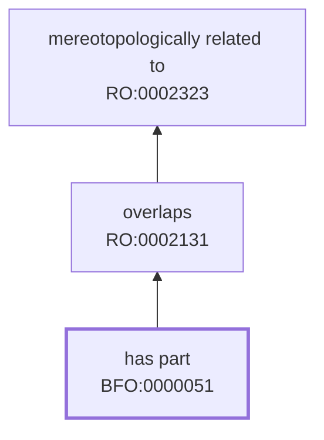

# has part (BFO:0000051)

[All terms](README.md) · [Term table](../ontology_terms.csv)

- **Kind:** relation
- **Source:** BFO
- **IRI:** <http://purl.obolibrary.org/obo/BFO_0000051>
- **Parent(s):** RO:0002131

> a core relation that holds between a whole and its part

## Spreadsheet rows

| Row | Requirement | Use case | Decision | Requirement text |
|---|---|---|---|---|
| T031 | BGC-02 | bgc | proposed | A BGC has genes as parts |
