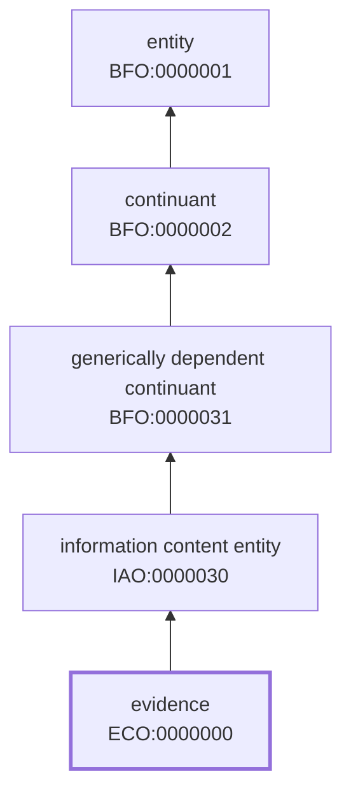

# evidence (ECO:0000000)

[All terms](README.md) · [Term table](../ontology_terms.csv)

- **Kind:** class
- **Source:** ECO
- **IRI:** <http://purl.obolibrary.org/obo/ECO_0000000>
- **Parent(s):** IAO:0000030

> A type of information that is used to support an assertion.

## Spreadsheet rows

| Row | Requirement | Use case | Decision | Requirement text |
|---|---|---|---|---|
| T003 | COM-02 | common | proposed | The type of evidence is stated with a controlled class |
