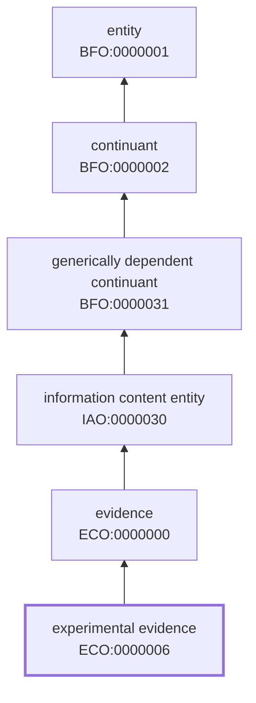

# experimental evidence (ECO:0000006)

[All terms](README.md) · [Term table](../ontology_terms.csv)

- **Kind:** class
- **Source:** ECO
- **IRI:** <http://purl.obolibrary.org/obo/ECO_0000006>
- **Parent(s):** ECO:0000000

> A type of evidence that is the output of a scientific procedure performed to make a discovery, test a hypothesis, or demonstrate a known fact.

## Spreadsheet rows

| Row | Requirement | Use case | Decision | Requirement text |
|---|---|---|---|---|
| T018 | PMN-03 | plantcyc | proposed | Experimental evidence, not further specified (EV-EXP) |
