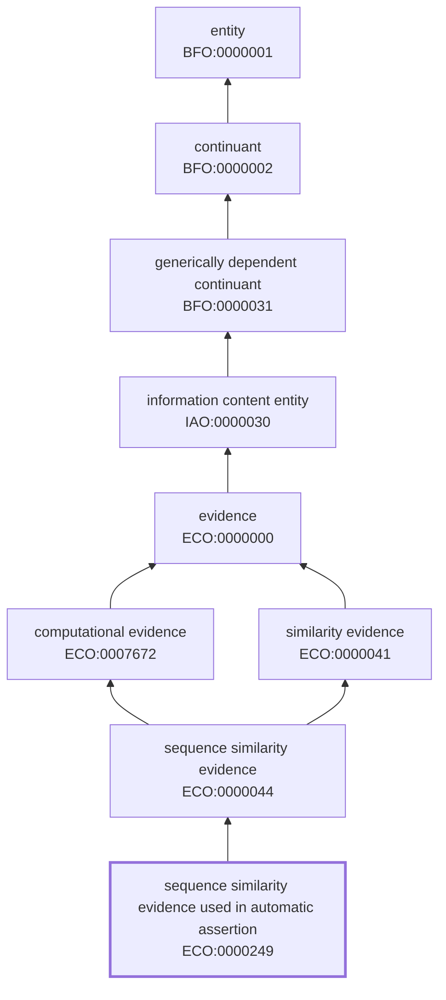

# sequence similarity evidence used in automatic assertion (ECO:0000249)

[All terms](README.md) · [Term table](../ontology_terms.csv)

- **Kind:** class
- **Source:** ECO
- **IRI:** <http://purl.obolibrary.org/obo/ECO_0000249>
- **Parent(s):** ECO:0000044

> A type of sequence similarity evidence that is used in an automatic assertion.

## Spreadsheet rows

| Row | Requirement | Use case | Decision | Requirement text |
|---|---|---|---|---|
| T039 | BGC-10 | bgc | proposed | The MIBiG match is supported by gene similarity (KnownClusterBLAST) |
