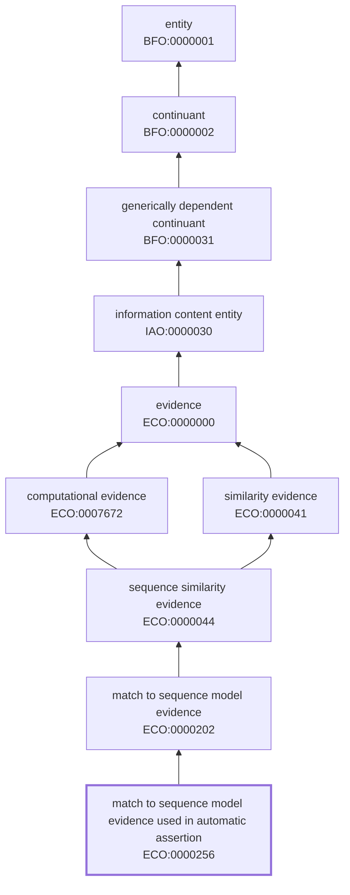

# match to sequence model evidence used in automatic assertion (ECO:0000256)

[All terms](README.md) · [Term table](../ontology_terms.csv)

- **Kind:** class
- **Source:** ECO
- **IRI:** <http://purl.obolibrary.org/obo/ECO_0000256>
- **Parent(s):** ECO:0000202

> A type of match to sequence model evidence that is used in an automatic assertion.

## Spreadsheet rows

| Row | Requirement | Use case | Decision | Requirement text |
|---|---|---|---|---|
| T032 | BGC-03 | bgc | proposed | The BGC was predicted computationally by sequence-model (pHMM) rules |
