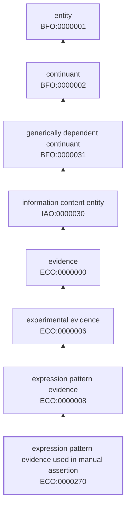

# expression pattern evidence used in manual assertion (ECO:0000270)

[All terms](README.md) · [Term table](../ontology_terms.csv)

- **Kind:** class
- **Source:** ECO
- **IRI:** <http://purl.obolibrary.org/obo/ECO_0000270>
- **Parent(s):** ECO:0000008

> A type of expression pattern evidence that is used in a manual assertion.

## Spreadsheet rows

| Row | Requirement | Use case | Decision | Requirement text |
|---|---|---|---|---|
| T017 | PMN-02 | plantcyc | proposed | Experimental evidence: expression pattern (EV-EXP-IEP) |
