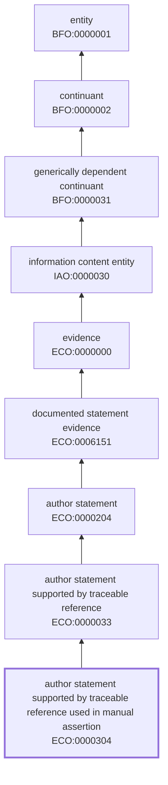

# author statement supported by traceable reference used in manual assertion (ECO:0000304)

[All terms](README.md) · [Term table](../ontology_terms.csv)

- **Kind:** class
- **Source:** ECO
- **IRI:** <http://purl.obolibrary.org/obo/ECO_0000304>
- **Parent(s):** ECO:0000033

> A type of author statement supported by traceable reference that is used in a manual assertion.

## Spreadsheet rows

| Row | Requirement | Use case | Decision | Requirement text |
|---|---|---|---|---|
| T019 | PMN-04 | plantcyc | proposed | Author statement with traceable support (EV-EXP-TAS, EV-AS-TAS) |
