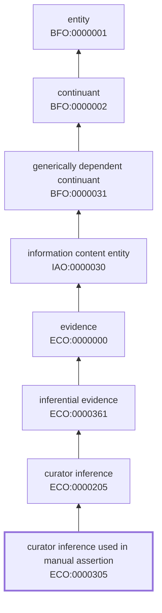

# curator inference used in manual assertion (ECO:0000305)

[All terms](README.md) · [Term table](../ontology_terms.csv)

- **Kind:** class
- **Source:** ECO
- **IRI:** <http://purl.obolibrary.org/obo/ECO_0000305>
- **Parent(s):** ECO:0000205

> A type of curator inference that is used in a manual assertion.

## Spreadsheet rows

| Row | Requirement | Use case | Decision | Requirement text |
|---|---|---|---|---|
| T020 | PMN-05 | plantcyc | proposed | Inferred by a curator (EV-IC) |
