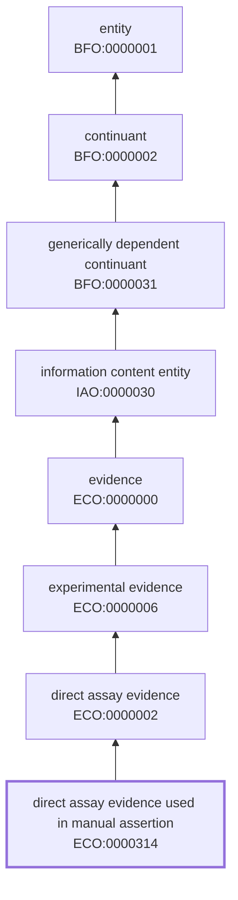

# direct assay evidence used in manual assertion (ECO:0000314)

[All terms](README.md) · [Term table](../ontology_terms.csv)

- **Kind:** class
- **Source:** ECO
- **IRI:** <http://purl.obolibrary.org/obo/ECO_0000314>
- **Parent(s):** ECO:0000002

> A type of direct assay evidence that is used in a manual assertion.

## Spreadsheet rows

| Row | Requirement | Use case | Decision | Requirement text |
|---|---|---|---|---|
| T016 | PMN-01 | plantcyc | proposed | Experimental evidence: direct assay (EV-EXP-IDA and its purified / unpurified-protein variants) |
