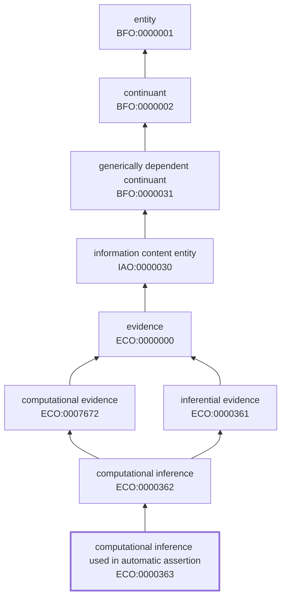

# computational inference used in automatic assertion (ECO:0000363)

[All terms](README.md) · [Term table](../ontology_terms.csv)

- **Kind:** class
- **Source:** ECO
- **IRI:** <http://purl.obolibrary.org/obo/ECO_0000363>
- **Parent(s):** ECO:0000362

> A type of evidence based on computational logical inference that is used in automatic assertion.

## Spreadsheet rows

| Row | Requirement | Use case | Decision | Requirement text |
|---|---|---|---|---|
| T025 | PMN-08 | plantcyc | open | Computational inference without human oversight (EV-COMP-AINF) |
