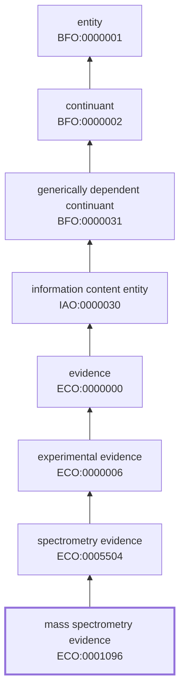

# mass spectrometry evidence (ECO:0001096)

[All terms](README.md) · [Term table](../ontology_terms.csv)

- **Kind:** class
- **Source:** ECO
- **IRI:** <http://purl.obolibrary.org/obo/ECO_0001096>
- **Parent(s):** ECO:0005504

> A type of spectrometry evidence resulting from identifying the amount and type of material entities present in a sample by fragmenting it and measuring the mass-to-charge ratio of the resulting particles.

## Spreadsheet rows

| Row | Requirement | Use case | Decision | Requirement text |
|---|---|---|---|---|
| T191 | MET-28 | metabolomics | open | The annotation rests on the accurate mass of an MS1 feature only (no fragment spectrum) |
