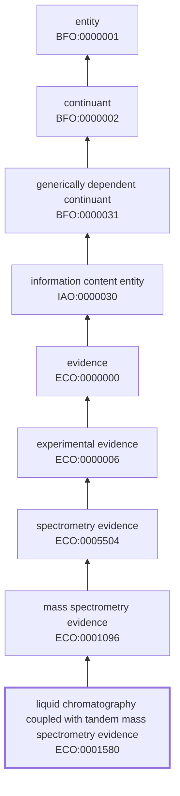

# liquid chromatography coupled with tandem mass spectrometry evidence (ECO:0001580)

[All terms](README.md) · [Term table](../ontology_terms.csv)

- **Kind:** class
- **Source:** ECO
- **IRI:** <http://purl.obolibrary.org/obo/ECO_0001580>
- **Parent(s):** ECO:0001096

> A type of mass spectrometry evidence where liquid chromatography is used to separate particles in solution, followed by fragmentation and measurement of the mass-to-charge ratio of the resulting particles to identify the amount and type of material entities present in a sample.

## Spreadsheet rows

| Row | Requirement | Use case | Decision | Requirement text |
|---|---|---|---|---|
| T048 | MET-01 | metabolomics | open | The annotation comes from LC-MS/MS data |
