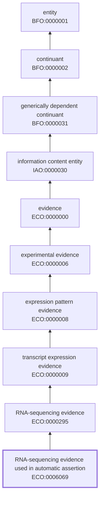

# RNA-sequencing evidence used in automatic assertion (ECO:0006069)

[All terms](README.md) · [Term table](../ontology_terms.csv)

- **Kind:** class
- **Source:** ECO
- **IRI:** <http://purl.obolibrary.org/obo/ECO_0006069>
- **Parent(s):** ECO:0000295

> A type of high throughput nucleotide sequencing assay evidence used in an automatic assertion based on high-throughput (HT) sequencing of fragmented cDNA molecules.

## Spreadsheet rows

| Row | Requirement | Use case | Decision | Requirement text |
|---|---|---|---|---|
| T132 | TX-02 | transcriptomics | proposed | Evidence: the statement is based on RNA-seq expression data |
