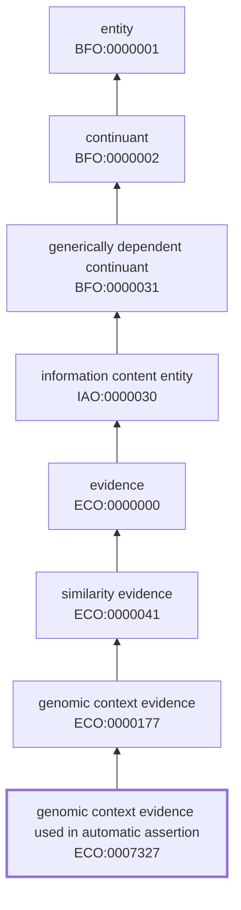

# genomic context evidence used in automatic assertion (ECO:0007327)

[All terms](README.md) · [Term table](../ontology_terms.csv)

- **Kind:** class
- **Source:** ECO
- **IRI:** <http://purl.obolibrary.org/obo/ECO_0007327>
- **Parent(s):** ECO:0000177

> A type of genomic context evidence that is used in an automatic assertion.

## Spreadsheet rows

| Row | Requirement | Use case | Decision | Requirement text |
|---|---|---|---|---|
| T033 | BGC-04 | bgc | proposed | The prediction is based on the co-location of genes in the genome |
