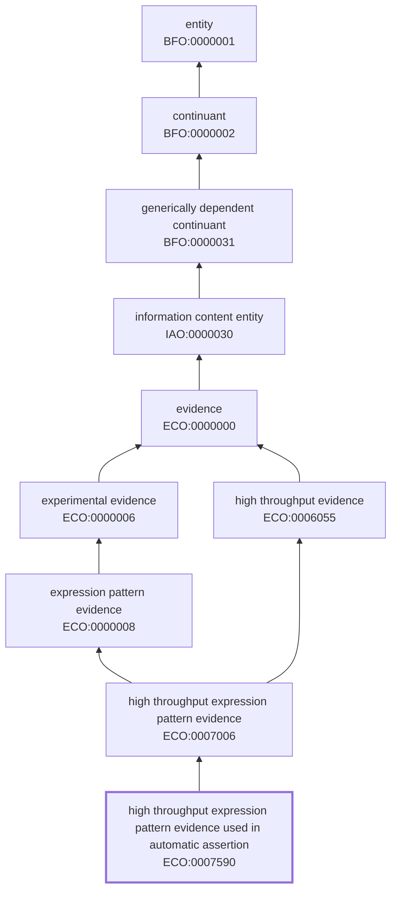

# high throughput expression pattern evidence used in automatic assertion (ECO:0007590)

[All terms](README.md) · [Term table](../ontology_terms.csv)

- **Kind:** class
- **Source:** ECO
- **IRI:** <http://purl.obolibrary.org/obo/ECO_0007590>
- **Parent(s):** ECO:0007006

> A type of high throughput expression pattern evidence that is used in an automatic assertion.

## Spreadsheet rows

| Row | Requirement | Use case | Decision | Requirement text |
|---|---|---|---|---|
| T082 | PO-03 | paired_omics | proposed | Evidence: transcript and metabolite abundances are correlated |
