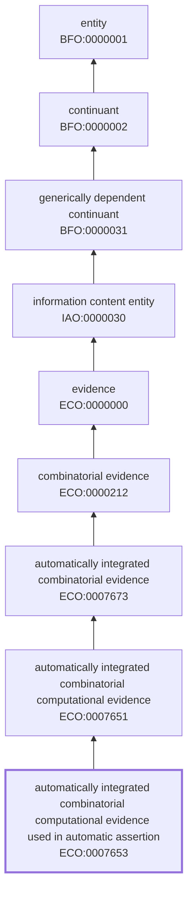

# automatically integrated combinatorial computational evidence used in automatic assertion (ECO:0007653)

[All terms](README.md) · [Term table](../ontology_terms.csv)

- **Kind:** class
- **Source:** ECO
- **IRI:** <http://purl.obolibrary.org/obo/ECO_0007653>
- **Parent(s):** ECO:0007651

> A type of automatically integrated combinatorial computational evidence that is used in an automatic assertion.

## Spreadsheet rows

| Row | Requirement | Use case | Decision | Requirement text |
|---|---|---|---|---|
| T049 | MET-02 | metabolomics | proposed | Several tools were combined automatically (consensus annotation) |
