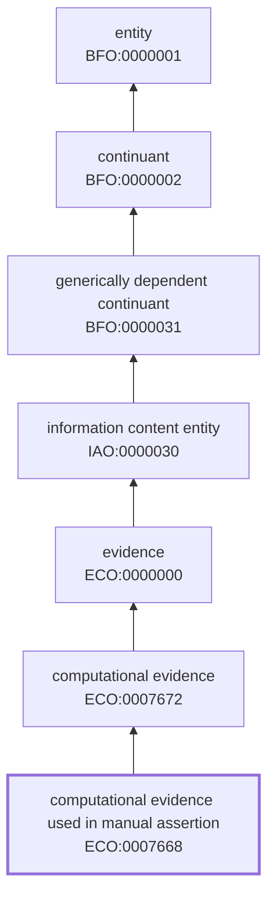

# computational evidence used in manual assertion (ECO:0007668)

[All terms](README.md) · [Term table](../ontology_terms.csv)

- **Kind:** class
- **Source:** ECO
- **IRI:** <http://purl.obolibrary.org/obo/ECO_0007668>
- **Parent(s):** ECO:0007672

> A type of computational evidence that is used in a manual assertion.

## Spreadsheet rows

| Row | Requirement | Use case | Decision | Requirement text |
|---|---|---|---|---|
| T022 | PMN-07 | plantcyc | open | Computational inference reviewed by a curator (EV-COMP-HINF) |
