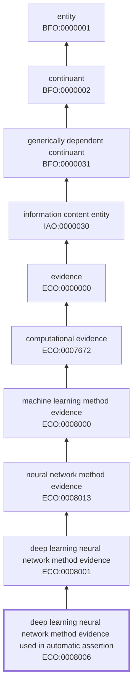

# deep learning neural network method evidence used in automatic assertion (ECO:0008006)

[All terms](README.md) · [Term table](../ontology_terms.csv)

- **Kind:** class
- **Source:** ECO
- **IRI:** <http://purl.obolibrary.org/obo/ECO_0008006>
- **Parent(s):** ECO:0008001

> A type of deep learning neural network method evidence that is used in an automatic assertion.

## Spreadsheet rows

| Row | Requirement | Use case | Decision | Requirement text |
|---|---|---|---|---|
| T052 | MET-03 | metabolomics | open | A single in-silico tool proposed the structure (SIRIUS, MS2Query, DreaMS) |
| T116 | UN-02 | unsupervised | open | Evidence: a machine-learning model predicted the link |
