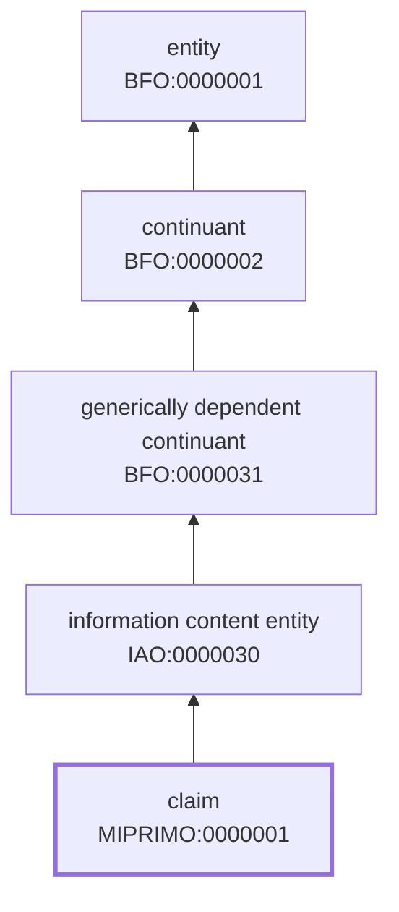

# claim (MIPRIMO:0000001)

[All terms](README.md) · [Term table](../ontology_terms.csv)

- **Kind:** class
- **Source:** MIPRIMO (new term)
- **IRI:** `https://example.org/miprimo/MIPRIMO_0000001` (placeholder namespace)
- **Replaces:** `lodp:Claim`
- **Parent(s):** IAO:0000030

> An information content entity that states a relation between biological entities or data items (for example a gene and a metabolite, or a spectral feature and a chemical structure), produced by a tool or a curator and supported by one or more evidence items.

No spreadsheet row of its own (added to MIPRIMO from the pilots' vocabulary).
