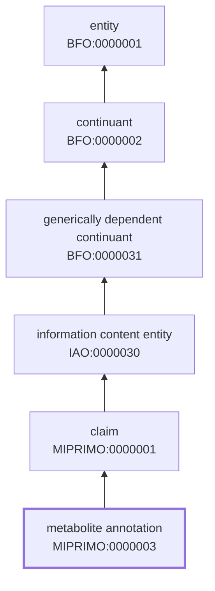

# metabolite annotation (MIPRIMO:0000003)

[All terms](README.md) · [Term table](../ontology_terms.csv)

- **Kind:** class
- **Source:** MIPRIMO (new term)
- **IRI:** `https://example.org/miprimo/MIPRIMO_0000003` (placeholder namespace)
- **Replaces:** `lodp:MetaboliteAnnotation`
- **Parent(s):** MIPRIMO:0000001

> A claim that a metabolite feature corresponds to a given chemical structure, as proposed by an annotation tool.

## Spreadsheet rows

| Row | Requirement | Use case | Decision | Requirement text |
|---|---|---|---|---|
| T062 | MET-09 | metabolomics | proposed | An MS feature is annotated as a PlantMetWiki metabolite |
