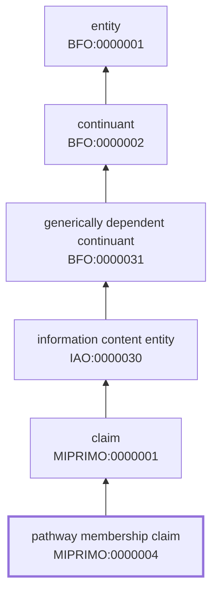

# pathway membership claim (MIPRIMO:0000004)

[All terms](README.md) · [Term table](../ontology_terms.csv)

- **Kind:** class
- **Source:** MIPRIMO (new term)
- **IRI:** `https://example.org/miprimo/MIPRIMO_0000004` (placeholder namespace)
- **Replaces:** `lodp:PathwayMembershipClaim`
- **Parent(s):** MIPRIMO:0000001

> A claim by a curator that a gene, enzyme or metabolite takes part in a given pathway.

No spreadsheet row of its own (added to MIPRIMO from the pilots' vocabulary).
