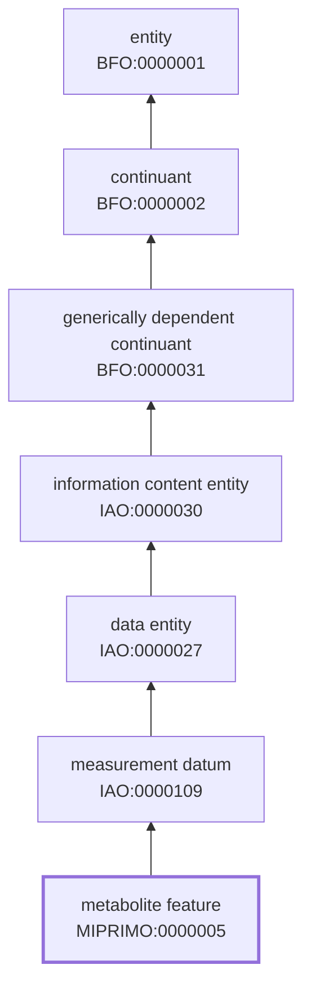

# metabolite feature (MIPRIMO:0000005)

[All terms](README.md) · [Term table](../ontology_terms.csv)

- **Kind:** class
- **Source:** MIPRIMO (new term)
- **IRI:** `https://example.org/miprimo/MIPRIMO_0000005` (placeholder namespace)
- **Replaces:** `lodp:MetaboliteFeature`
- **Parent(s):** IAO:0000109

> A measurement datum from untargeted mass spectrometry that records one detected ion signal by its m/z value and retention time in a dataset.

## Spreadsheet rows

| Row | Requirement | Use case | Decision | Requirement text |
|---|---|---|---|---|
| T071 | MET-13 | metabolomics | proposed | An untargeted MS feature as a resource (m/z, retention time, scan polarity, dataset) |
