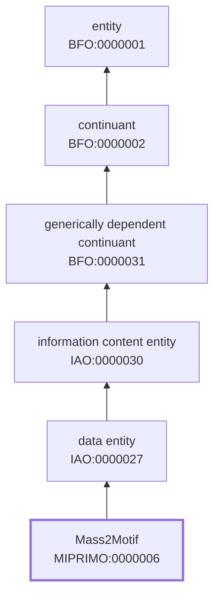

# Mass2Motif (MIPRIMO:0000006)

[All terms](README.md) · [Term table](../ontology_terms.csv)

- **Kind:** class
- **Source:** MIPRIMO (new term)
- **IRI:** `https://example.org/miprimo/MIPRIMO_0000006` (placeholder namespace)
- **Replaces:** `lodp:Mass2Motif`
- **Parent(s):** IAO:0000027

> A data entity produced by an MS2LDA topic model: a set of fragment and neutral-loss m/z values, with weights, that co-occur in MS/MS spectra.

## Spreadsheet rows

| Row | Requirement | Use case | Decision | Requirement text |
|---|---|---|---|---|
| T188 | MET-27 | metabolomics | proposed | A Mass2Motif (MS2LDA pattern of fragments and neutral losses) is assigned to a feature with a probability |
