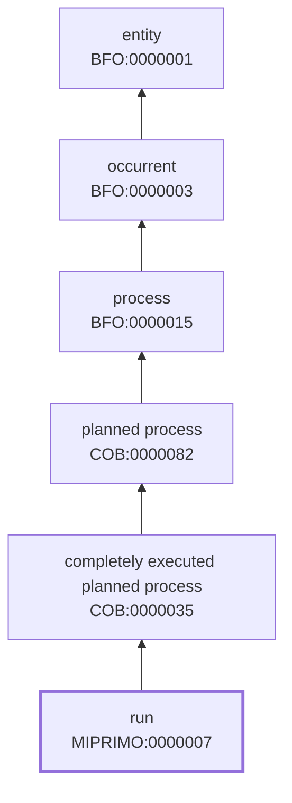

# run (MIPRIMO:0000007)

[All terms](README.md) · [Term table](../ontology_terms.csv)

- **Kind:** class
- **Source:** MIPRIMO (new term)
- **IRI:** `https://example.org/miprimo/MIPRIMO_0000007` (placeholder namespace)
- **Replaces:** `lodp:Run`
- **Parent(s):** COB:0000035

> A planned process in which a tool, a pipeline or a curator produces claims or evidence; a run records the software, its version and the input data it used.

## Spreadsheet rows

| Row | Requirement | Use case | Decision | Requirement text |
|---|---|---|---|---|
| T009 | COM-07 | common | proposed | Kinds of run are distinguished (prediction tool, linking, consensus, curation) |
