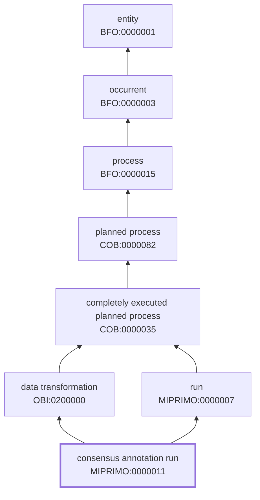

# consensus annotation run (MIPRIMO:0000011)

[All terms](README.md) · [Term table](../ontology_terms.csv)

- **Kind:** class
- **Source:** MIPRIMO (new term)
- **IRI:** `https://example.org/miprimo/MIPRIMO_0000011` (placeholder namespace)
- **Replaces:** `lodp:ConsensusAnnotationRun`
- **Parent(s):** OBI:0200000, MIPRIMO:0000007

> A run that combines the results of several annotation tool runs into consensus metabolite annotations.

No spreadsheet row of its own (added to MIPRIMO from the pilots' vocabulary).
