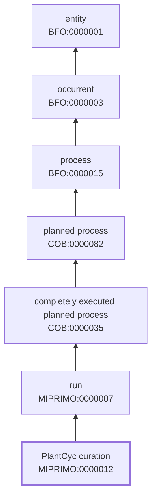

# PlantCyc curation (MIPRIMO:0000012)

[All terms](README.md) · [Term table](../ontology_terms.csv)

- **Kind:** class
- **Source:** MIPRIMO (new term)
- **IRI:** `https://example.org/miprimo/MIPRIMO_0000012` (placeholder namespace)
- **Replaces:** `lodp:PlantCycCuration`
- **Parent(s):** MIPRIMO:0000007

> A run in which PlantCyc curators assert pathway membership from the literature.

No spreadsheet row of its own (added to MIPRIMO from the pilots' vocabulary).
