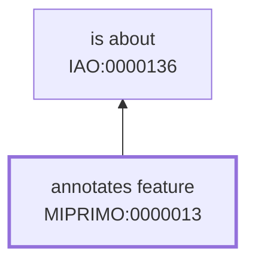

# annotates feature (MIPRIMO:0000013)

[All terms](README.md) · [Term table](../ontology_terms.csv)

- **Kind:** relation
- **Source:** MIPRIMO (new term)
- **IRI:** `https://example.org/miprimo/MIPRIMO_0000013` (placeholder namespace)
- **Replaces:** `lodp:feature`
- **Parent(s):** IAO:0000136

> Relates a metabolite annotation to the metabolite feature it annotates.

No spreadsheet row of its own (added to MIPRIMO from the pilots' vocabulary).
