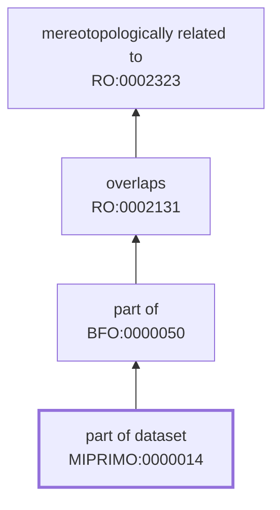

# part of dataset (MIPRIMO:0000014)

[All terms](README.md) · [Term table](../ontology_terms.csv)

- **Kind:** relation
- **Source:** MIPRIMO (new term)
- **IRI:** `https://example.org/miprimo/MIPRIMO_0000014` (placeholder namespace)
- **Replaces:** `lodp:dataset`
- **Parent(s):** BFO:0000050

> Relates a data item, such as a metabolite feature, to the dataset it is part of.

## Spreadsheet rows

| Row | Requirement | Use case | Decision | Requirement text |
|---|---|---|---|---|
| T079 | MET-18 | metabolomics | proposed | The study or dataset a feature comes from |
| T128 | UN-11 | unsupervised | open | The benchmark dataset the model was trained and evaluated on |
| T166 | TX-21 | transcriptomics | proposed | The sequencing dataset the expression values come from (BioProject, SRA or GEO accession) |
