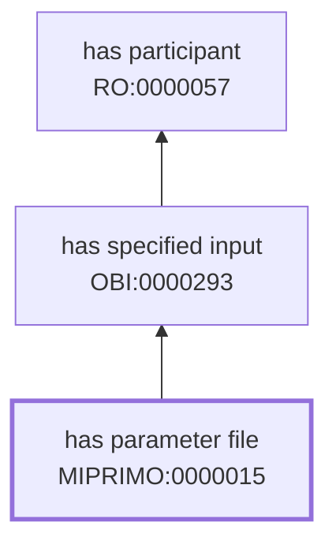

# has parameter file (MIPRIMO:0000015)

[All terms](README.md) · [Term table](../ontology_terms.csv)

- **Kind:** relation
- **Source:** MIPRIMO (new term)
- **IRI:** `https://example.org/miprimo/MIPRIMO_0000015` (placeholder namespace)
- **Replaces:** `lodp:batchFile`
- **Parent(s):** OBI:0000293

> Relates a run to the parameter file it used, for example an mzmine batch file.

## Spreadsheet rows

| Row | Requirement | Use case | Decision | Requirement text |
|---|---|---|---|---|
| T182 | MET-23 | metabolomics | proposed | Feature detection and alignment run (mzmine batch) that produced the feature table |
