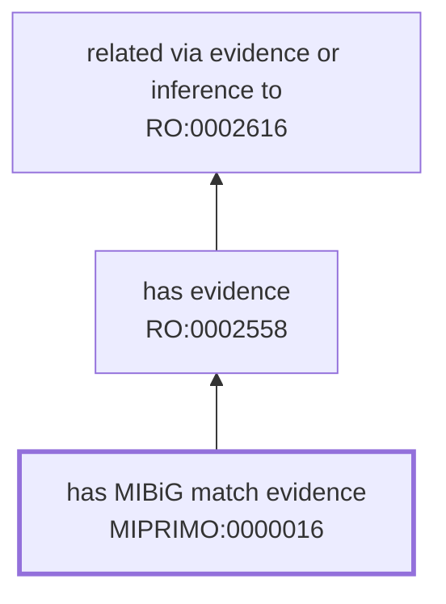

# has MIBiG match evidence (MIPRIMO:0000016)

[All terms](README.md) · [Term table](../ontology_terms.csv)

- **Kind:** relation
- **Source:** MIPRIMO (new term)
- **IRI:** `https://example.org/miprimo/MIPRIMO_0000016` (placeholder namespace)
- **Replaces:** `lodp:mibigMatchEvidence`
- **Parent(s):** RO:0002558

> Relates a biosynthetic gene cluster to the evidence for its similarity to a MIBiG reference cluster, such as a KnownClusterBLAST result.

No spreadsheet row of its own (added to MIPRIMO from the pilots' vocabulary).
