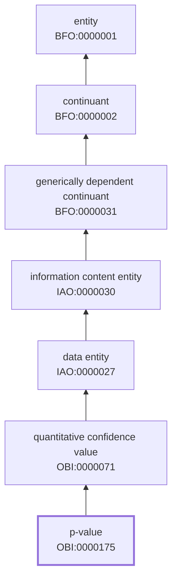

# p-value (OBI:0000175)

[All terms](README.md) · [Term table](../ontology_terms.csv)

- **Kind:** class
- **Source:** OBI
- **IRI:** <http://purl.obolibrary.org/obo/OBI_0000175>
- **Parent(s):** OBI:0000071

> A quantitative confidence value that represents the probability of obtaining a result at least as extreme as that actually obtained, assuming that the actual value was the result of chance alone.

## Spreadsheet rows

| Row | Requirement | Use case | Decision | Requirement text |
|---|---|---|---|---|
| T087 | PO-05 | paired_omics | proposed | Significance of the correlation |
| T095 | PO-09 | paired_omics | open | Significance of the functional cluster |
