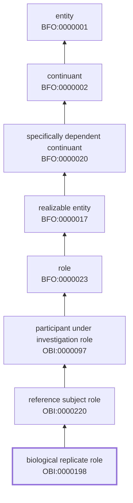

# biological replicate role (OBI:0000198)

[All terms](README.md) · [Term table](../ontology_terms.csv)

- **Kind:** class
- **Source:** OBI
- **IRI:** <http://purl.obolibrary.org/obo/OBI_0000198>
- **Parent(s):** OBI:0000220

> a reference participant role realized by equivalent treatment of participants

## Spreadsheet rows

| Row | Requirement | Use case | Decision | Requirement text |
|---|---|---|---|---|
| T161 | TX-18 | transcriptomics | open | Replicates of a condition |
