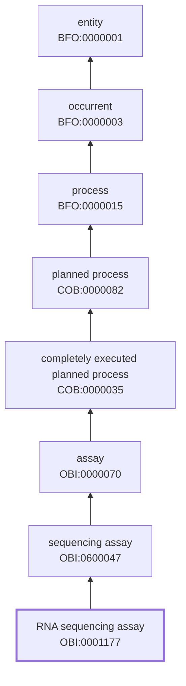

# RNA sequencing assay (OBI:0001177)

[All terms](README.md) · [Term table](../ontology_terms.csv)

- **Kind:** class
- **Source:** OBI
- **IRI:** <http://purl.obolibrary.org/obo/OBI_0001177>
- **Parent(s):** OBI:0600047

> An assay that determines the sequence of an RNA molecule.

## Spreadsheet rows

| Row | Requirement | Use case | Decision | Requirement text |
|---|---|---|---|---|
| T130 | TX-01 | transcriptomics | proposed | Expression was measured by RNA sequencing |
