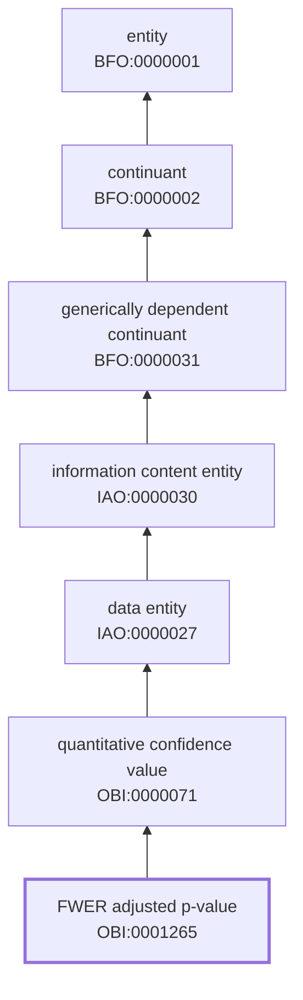

# FWER adjusted p-value (OBI:0001265)

[All terms](README.md) · [Term table](../ontology_terms.csv)

- **Kind:** class
- **Source:** OBI
- **IRI:** <http://purl.obolibrary.org/obo/OBI_0001265>
- **Parent(s):** OBI:0000071

> A quantitative confidence value resulting from a multiple testing error correction method which adjusts the p-value used as input to control for Type I error in the context of multiple pairwise tests

## Spreadsheet rows

| Row | Requirement | Use case | Decision | Requirement text |
|---|---|---|---|---|
| T088 | PO-05 | paired_omics | open | Significance of the correlation |
| T152 | TX-12 | transcriptomics | open | Adjusted p-value of a differential expression result (DESeq2 padj) |
