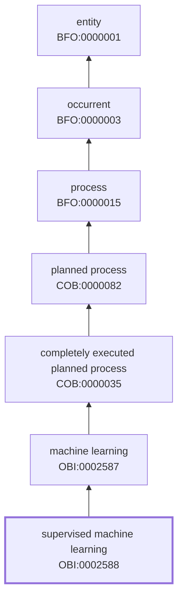

# supervised machine learning (OBI:0002588)

[All terms](README.md) · [Term table](../ontology_terms.csv)

- **Kind:** class
- **Source:** OBI
- **IRI:** <http://purl.obolibrary.org/obo/OBI_0002588>
- **Parent(s):** OBI:0002587

> A machine learning process using a function that maps an input to an output based on example input-output pairs. It infers a function from labeled training data consisting of a set of training examples.

## Spreadsheet rows

| Row | Requirement | Use case | Decision | Requirement text |
|---|---|---|---|---|
| T119 | UN-04 | unsupervised | open | Training procedure (supervised learning on known links) |
