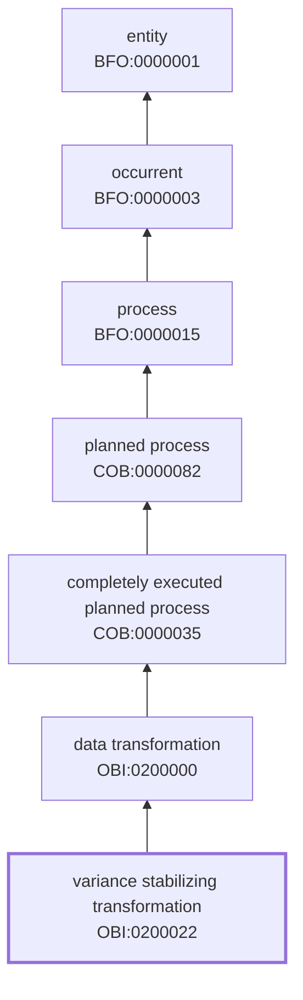

# variance stabilizing transformation (OBI:0200022)

[All terms](README.md) · [Term table](../ontology_terms.csv)

- **Kind:** class
- **Source:** OBI
- **IRI:** <http://purl.obolibrary.org/obo/OBI_0200022>
- **Parent(s):** OBI:0200000

> A variance stabilizing transformation is a data transformation, described in PMID 12169536, whose input is a matrix [y_ik] and whose output is a matrix obtained by applying formula (6) in this paper. One of the goals is to obtain an output matrix whose rows have equal variances. The method relies on various assumptions described in the paper.

## Spreadsheet rows

| Row | Requirement | Use case | Decision | Requirement text |
|---|---|---|---|---|
| T139 | TX-05 | transcriptomics | open | Normalisation method (library-size normalisation, TMM, variance-stabilising transformation) |
