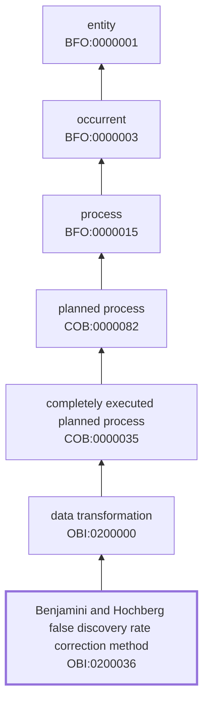

# Benjamini and Hochberg false discovery rate correction method (OBI:0200036)

[All terms](README.md) · [Term table](../ontology_terms.csv)

- **Kind:** class
- **Source:** OBI
- **IRI:** <http://purl.obolibrary.org/obo/OBI_0200036>
- **Parent(s):** OBI:0200000

> A data transformation process in which the Benjamini and Hochberg method sequential p-value procedure  is applied with the aim of correcting false discovery rate

## Spreadsheet rows

| Row | Requirement | Use case | Decision | Requirement text |
|---|---|---|---|---|
| T153 | TX-13 | transcriptomics | proposed | Multiple-testing correction method (Benjamini-Hochberg, the DESeq2 default) |
