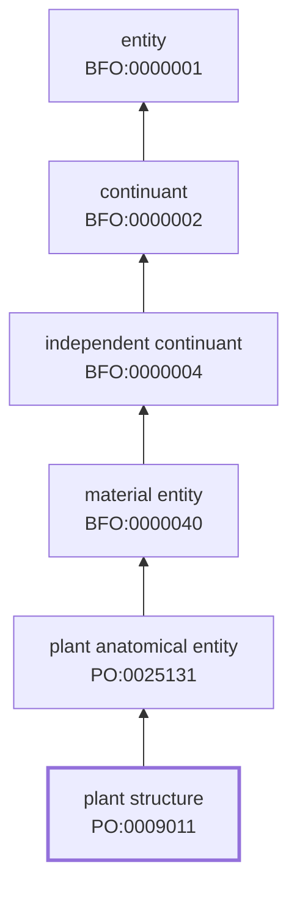

# plant structure (PO:0009011)

[All terms](README.md) · [Term table](../ontology_terms.csv)

- **Kind:** class
- **Source:** PO
- **IRI:** <http://purl.obolibrary.org/obo/PO_0009011>
- **Parent(s):** PO:0025131

> A plant anatomical entity (PO:0025131) that is, or was, part of a plant, or was derived from a part of a plant.

## Spreadsheet rows

| Row | Requirement | Use case | Decision | Requirement text |
|---|---|---|---|---|
| T163 | TX-19 | transcriptomics | proposed | Plant structure (tissue or organ) the sample was taken from |
| T184 | MET-24 | metabolomics | proposed | Organism and plant structure of the sample in which a feature was measured |
