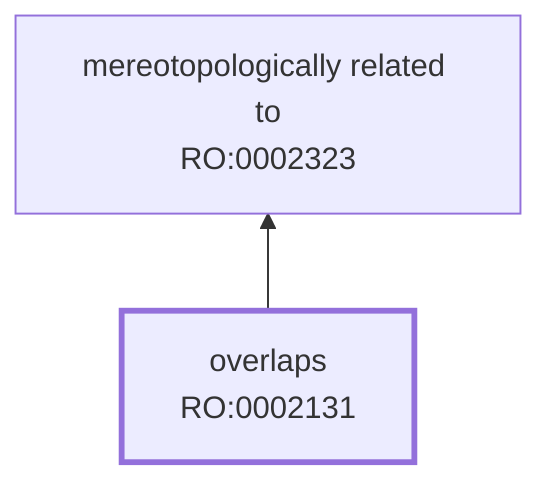

# overlaps (RO:0002131)

[All terms](README.md) · [Term table](../ontology_terms.csv)

- **Kind:** relation
- **Source:** RO
- **IRI:** <http://purl.obolibrary.org/obo/RO_0002131>
- **Parent(s):** RO:0002323

> x overlaps y if and only if there exists some z such that x has part z and z part of y

## Spreadsheet rows

| Row | Requirement | Use case | Decision | Requirement text |
|---|---|---|---|---|
| T042 | BGC-12 | bgc | open | The BGC overlaps a PlantMetWiki pathway |
