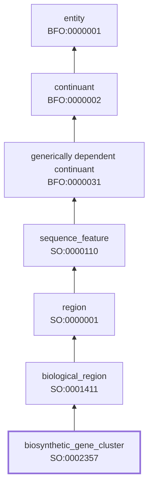

# biosynthetic_gene_cluster (SO:0002357)

[All terms](README.md) · [Term table](../ontology_terms.csv)

- **Kind:** class
- **Source:** SO
- **IRI:** <http://purl.obolibrary.org/obo/SO_0002357>
- **Parent(s):** SO:0001411

> A physically clustered group of two or more genes in a particular genome that together encode a biosynthetic pathway for the production of a specialized metabolite (including its chemical variants).

## Spreadsheet rows

| Row | Requirement | Use case | Decision | Requirement text |
|---|---|---|---|---|
| T030 | BGC-01 | bgc | proposed | There is a biosynthetic gene cluster |
