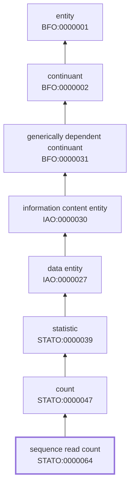

# sequence read count (STATO:0000064)

[All terms](README.md) · [Term table](../ontology_terms.csv)

- **Kind:** class
- **Source:** STATO
- **IRI:** <http://purl.obolibrary.org/obo/STATO_0000064>
- **Parent(s):** STATO:0000047

> sequence read count is a data item determining how many sequence reads have been generated by a DNA sequencing assay for a given stretch of DNA

## Spreadsheet rows

| Row | Requirement | Use case | Decision | Requirement text |
|---|---|---|---|---|
| T135 | TX-03 | transcriptomics | proposed | Raw read count of a gene in a sample |
